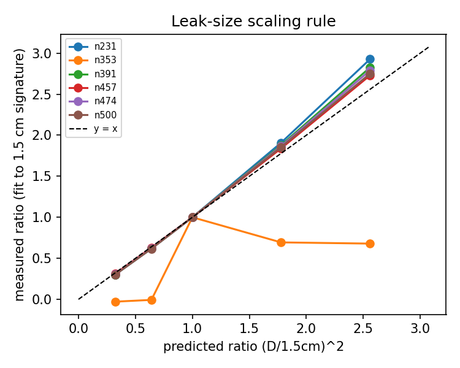
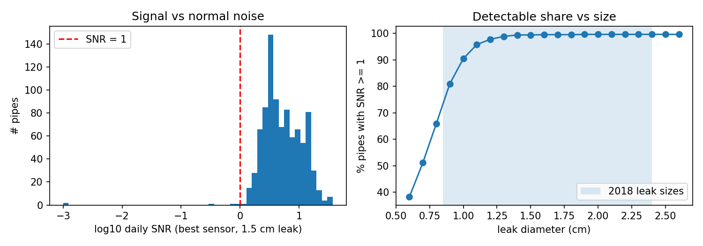
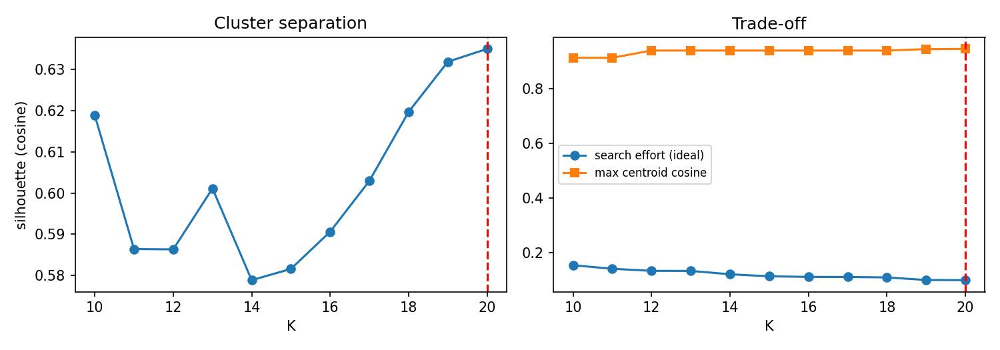
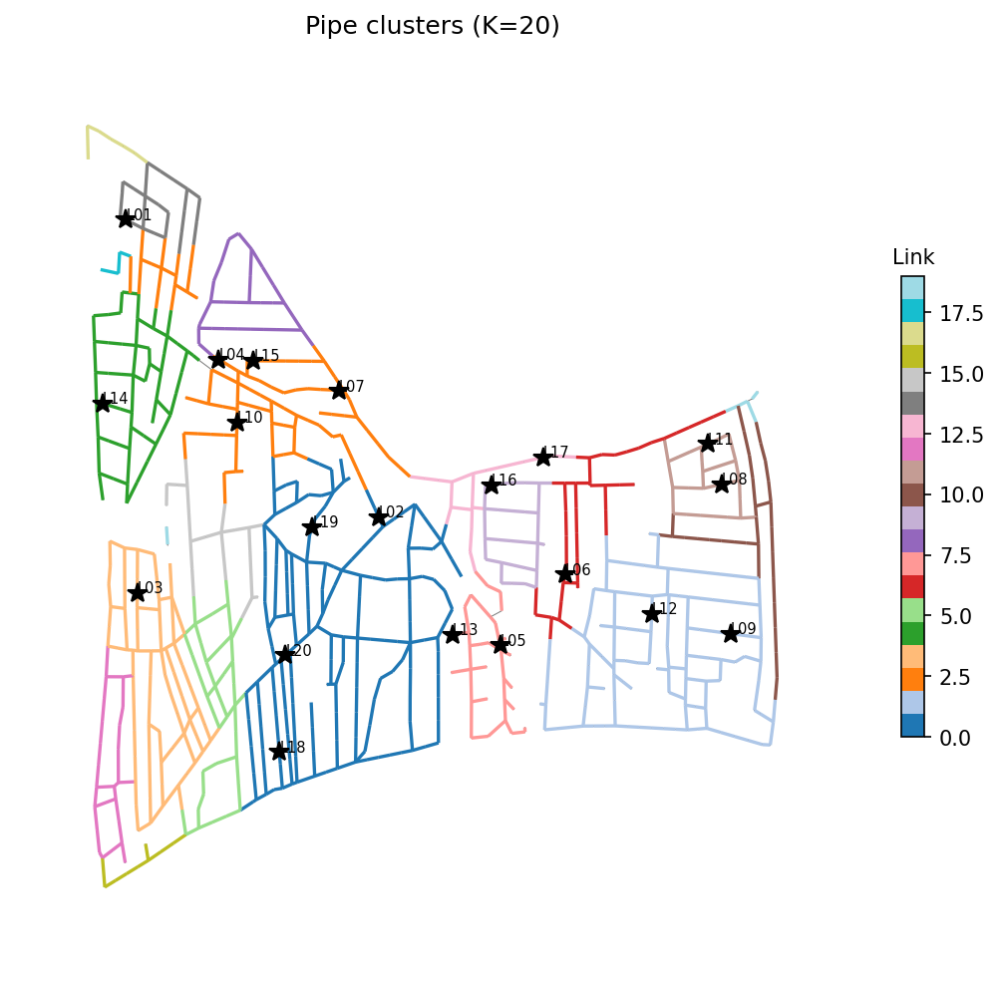
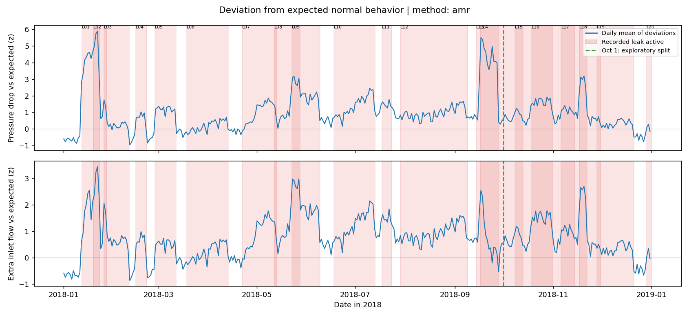
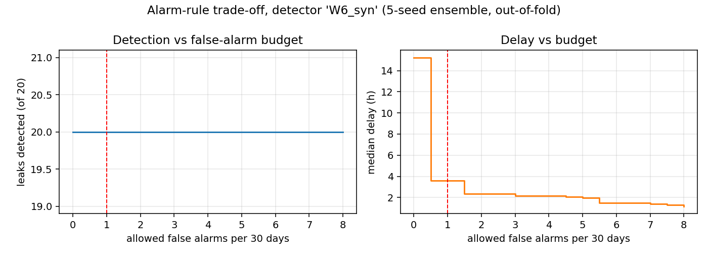
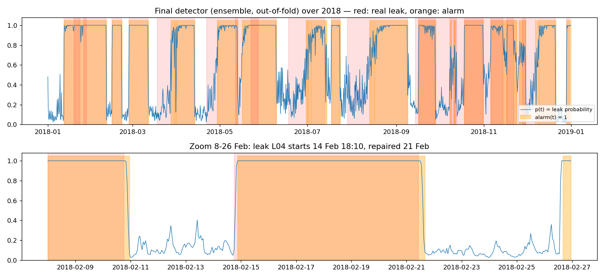
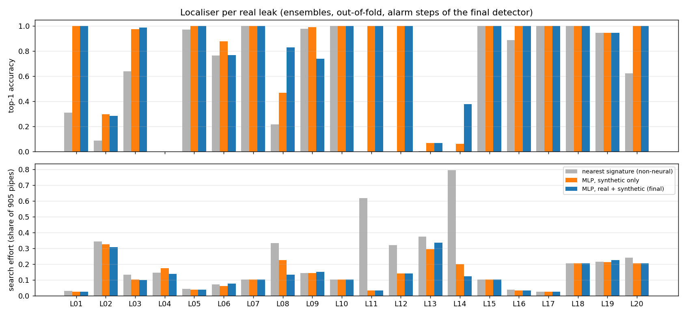
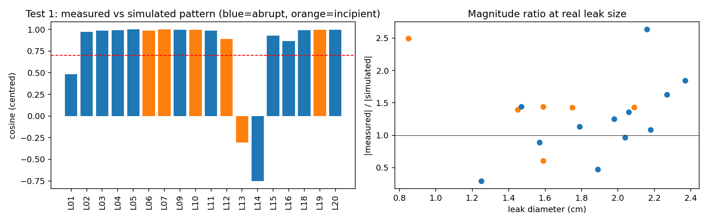
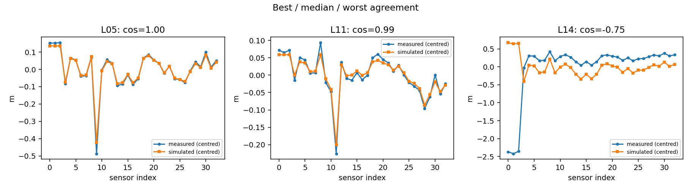

# تشخیص و مکان‌یابی نشت در شبکهٔ آب L-Town با شبکه‌های MLP

**پروژهٔ اول درس مقدمه‌ای بر یادگیری عمیق — پاییز ۱۴۰۵**  
دانشگاه صنعتی امیرکبیر، دانشکدهٔ ریاضی و علوم کامپیوتر  
استاد: دکتر فاطمه شاکری  
اعضای گروه: مارال مهاجر، پریا اصحابی، نگار کاظمی

## چکیده

هدف پروژه پاسخ به دو پرسش است: «آیا اکنون در شبکه نشت وجود دارد؟» و «اگر وجود دارد، در کدام گروه از لوله‌ها باید جست‌وجو را آغاز کرد؟» برای پرسش اول یک شبکهٔ MLP احتمال نشت را در هر گام پنج‌دقیقه‌ای پیش‌بینی می‌کند. برای پرسش دوم، MLP دیگری احتمال تعلق نشت به هر یک از ۲۰ خوشهٔ لوله را می‌دهد. هر دو شبکه فقط از لایه‌های تمام‌متصل ساخته شده‌اند.

خوشه‌ها با شبیه‌سازی اثر نشت روی ۳۳ حسگر فشار ساخته شدند. دادهٔ سال ۲۰۱۸ شامل ۲۰ رخداد نشت واقعی است. برای آموزش، از این داده و نشت‌هایی که اثر شبیه‌سازی‌شدهٔ آن‌ها به ساعات بدون نشتِ واقعی اضافه شده است استفاده کردیم. ارزیابی با چهار بلوک زمانی انجام شد: هر بار یک بلوک برای اعتبارسنجی و سه بلوک دیگر برای آموزش بود.

| معیار روی پیش‌بینی‌های خارج از آموزش | نتیجه |
|---|---:|
| AUROC آشکارساز | ۰٫۸۹۹ |
| رخدادهای دارای دست‌کم یک هشدار | ۲۰ از ۲۰ |
| میانهٔ زمان تا نخستین هشدار | ۳٫۶ ساعت |
| روزهای دارای هشدار کاذب، به ازای ۳۰ روز بدون نشت | ۰٫۴۵ |
| سهم لوله‌هایی که تا رسیدن به خوشهٔ درست جست‌وجو می‌شوند | ۰٫۱۳۰ |
| دقت خوشهٔ پیشنهادی اول | ۰٫۸۰۰ |

این اعداد به معنای تشخیص سریع همهٔ نشت‌ها نیستند. نشت‌های تدریجی گاهی چند روز پس از شروع دیده می‌شوند. همچنین، در چهار مورد نشتِ هم‌زمان، هشداری که هنگام شروع نشت دوم فعال بوده ممکن است در شمارش «تشخیص» آن نشت هم حساب شود. محدودیت‌های داده و بازهٔ عدم قطعیت عملکرد در بخش‌های ۳ و ۵ آمده‌اند.

# بخش ۱ — شناخت مسئله و خوشه‌بندی لوله‌ها

## ۱.۱ چرا خوشه‌بندی لازم است؟

شبکهٔ L-Town دارای ۷۸۲ گره و ۹۰۵ لوله است، اما فقط ۳۳ حسگر فشار دارد. اثر نشت در بعضی لوله‌ها روی این حسگرها بسیار شبیه است؛ بنابراین تعیین یک لولهٔ دقیق همیشه ممکن نیست. ما لوله‌های با اثر مشابه را در یک خوشه قرار دادیم. خروجی مکان‌یاب شمارهٔ خوشه است و گروه تعمیر لوله‌های خوشه‌های پیشنهادی را به ترتیب بررسی می‌کند.

این خوشه‌ها **پیش از آموزش دو MLP** ساخته شدند و در تمام آزمایش‌ها ثابت ماندند. فایل `clusters.csv` برای هر ۹۰۵ لوله یک شناسهٔ خوشه از ۰ تا ۱۹ دارد.

## ۱.۲ امضای نشت چگونه ساخته شد؟

مدل هیدرولیکی `network/L-TOWN_Model.inp` را با WNTR و EPANET اجرا کردیم. برای شبیه‌سازی نشت، از قابلیت *emitter* در EPANET استفاده کردیم. Emitter در این پروژه یک سوراخ فرضی در گرهٔ شبکه است: هرچه فشار آب در آن گره بیشتر باشد، آب بیشتری از سوراخ خارج می‌شود. قطر D در محاسبهٔ نشت، قطر **سوراخ نشت** است، نه قطر لوله.

پیش از شبیه‌سازی همهٔ گره‌ها، یک اجرای آزمایشی روی `n500` انجام دادیم. این گره را انتخاب کردیم چون راهنمای پروژه نشتِ ۱٫۵ سانتی‌متری روی همین گره را مثال زده و افزایش جریان ورودی را حدود ۱۵ مترمکعب‌برساعت اعلام کرده است. نتیجهٔ اجرای ما **۱۵٫۲۶ مترمکعب‌برساعت** بود. پس از این بررسی، نشت مرجع را در **همهٔ ۷۸۲ گره** شبیه‌سازی کردیم و یک اجرای بدون نشت را مبنای مقایسه قرار دادیم. هر اجرا ۴۸ ساعت با گام ۱۵ دقیقه طول کشید. روز نخست را کنار گذاشتیم تا حالت گذرای مخزن بر نتیجه اثر نگذارد.

برای هر حسگر، فشارِ حالت بدون نشت را از فشارِ حالت دارای نشت کم کردیم. میانگین این اختلاف در هر ساعت روز، **امضای گره** را به شکل یک آرایهٔ ۲۴ ساعت × ۳۳ حسگر می‌سازد. امضای لوله برابر میانگین امضای گره‌های دو سر آن است؛ اگر یک سر به منبع یا مخزن وصل باشد، فقط سرِ دارای امضای گره استفاده می‌شود. از فشار مطلق مدل استفاده نکردیم، چون مدل هیدرولیکی و شبکه‌ای که دادهٔ ۲۰۱۸ را ساخته است دقیقاً یکسان نیستند.

### چرا دو تقریب به کار بردیم؟

امضاها را برای گره‌های شبکه و با قطر مرجع **۱٫۵ سانتی‌متر** ساختیم. اما نشت‌های واقعی روی **لوله‌ها** رخ داده‌اند و قطرهای متفاوتی دارند. برای اینکه مجبور نباشیم هر لوله را با هر قطر جداگانه شبیه‌سازی کنیم، دو راه ساده‌تر را آزمودیم:

| مسئله | راه ساده‌تر | چگونه آن را آزمودیم؟ | نتیجه |
|---|---|---|---|
| قطر سوراخ نشت با ۱٫۵ سانتی‌متر فرق دارد. | اثر نشت مرجع را در `(D / 1.5)²` ضرب می‌کنیم؛ `D` قطر سوراخ بر حسب سانتی‌متر است. این روش فرض می‌کند اندازهٔ اثر تغییر می‌کند، اما شکل افت فشار روی حسگرها تقریباً ثابت می‌ماند. | نشت را در ۶ گره و با پنج قطر از ۰٫۸۵ تا ۲٫۴ سانتی‌متر جداگانه شبیه‌سازی کردیم و نتیجه را با این پیش‌بینی مقایسه کردیم. | در ۵ گره، نتیجه به شبیه‌سازی مستقیم نزدیک بود؛ در `n353` اختلاف زیادی داشت. از این روش برای ساخت دادهٔ مصنوعی استفاده کردیم، پس نمونه‌های دارای رفتار مشابه `n353` ممکن است دقیق نباشند. |
| نشت در وسط لوله است، اما شبیه‌سازی‌های اولیه برای گره‌ها انجام شده‌اند. | اثر نشت روی لوله را برابر **میانگین اثر نشت در دو گرهٔ انتهای آن** می‌گیریم. | در ۱۰ لوله، نشت را با `split_pipe` واقعاً در وسط لوله شبیه‌سازی کردیم و نتیجه را با میانگین دو سر مقایسه کردیم. | شکل افت فشار در حسگرها تقریباً یکسان بود: کمترین شباهت **۰٫۹۹۹۹**. اندازهٔ تخمینی نیز **۹۹٫۳٪ تا ۱۰۰٪** اندازهٔ شبیه‌سازی مستقیم بود؛ بنابراین این تقریب را پذیرفتیم. |

در آزمون قطر، اثرِ نشت ۱٫۵ سانتی‌متری را **۱** در نظر گرفتیم. مثلاً برای قطر ۰٫۸۵ سانتی‌متر در `n500`، ضریب پیش‌بینی‌شده **۰٫۳۲۱** و ضریب حاصل از شبیه‌سازی مستقیم **۰٫۳۰۰** بود. برای قطر ۲٫۴ سانتی‌متر، این دو عدد **۲٫۵۶۰** و **۲٫۷۵۱** بودند. در پنج گره از شش گره، اختلاف نتیجهٔ مستقیم با پیش‌بینی از **۱۴٫۴٪ مقدار پیش‌بینی‌شده** بیشتر نشد. اما در `n353` با قطر ۲٫۴ سانتی‌متر، ضریب پیش‌بینی‌شده **۲٫۵۶۰** و نتیجهٔ مستقیم فقط **۰٫۶۷۹** بود. جزئیات در `outputs/part1/check_size_rule.csv` و `outputs/part1/check_pipe_split.csv` ثبت شده‌اند.



## ۱.۳ کدام لوله‌ها با حسگرهای موجود دیده می‌شوند؟

برای خوشه‌بندی، ابتدا امضای ۲۴ ساعت هر لوله را به یک بردار ۳۳تایی تبدیل کردیم. سپس میانگین آن بردار را از همهٔ حسگرها کم کردیم و بردار حاصل را به طول یک نرمال کردیم. این کار باعث می‌شود **شکل مکانی افت فشار** مبنای خوشه‌بندی باشد، نه بزرگی افت.

نشت باعث افت فشار در حسگرها می‌شود، اما هر افت فشاری به پیدا کردن **محل نشت** کمک نمی‌کند. برای مثال، اگر فشار در همهٔ حسگرها تقریباً به یک اندازه کم شود، می‌فهمیم وضعیت شبکه تغییر کرده است، ولی از روی این تغییر نمی‌توانیم تشخیص دهیم نشت کنار کدام لوله رخ داده است. در نشت‌های شبیه‌سازی‌شده، برای نیمی از لوله‌ها دست‌کم **۷۱٪ انرژیِ الگوی افت فشار** از همین بخشِ تقریباً یکسان تشکیل می‌شد.

برای پیدا کردن محل نشت، به **تفاوت افت فشار میان حسگرها** نیاز داریم: حسگرهای نزدیک‌تر به نشت ممکن است افت بیشتری نشان دهند و حسگرهای دورتر افت کمتری. به همین دلیل، «امضای مرکزدار» را ساختیم؛ یعنی میانگین افت فشارِ ۳۳ حسگر را از افت فشار هر حسگر کم کردیم. به این ترتیب، بخش مشترکِ تغییر فشار کنار می‌رود و تفاوت میان حسگرها واضح‌تر می‌شود.

البته این تفاوت‌ها هم ممکن است زیر تغییرات عادی فشار پنهان شوند. برای بررسی این موضوع، فشار را ساعتی کردیم و **۱۴۰۴ ساعتِ بدون نشت** از ژانویه تا سپتامبر برداشتیم. ابتدا برای هر حسگر، میانگین فشارِ همان ساعت روز را با تفکیک روز کاری و آخر هفته کم کردیم. سپس تغییرات باقی‌مانده را برای محاسبهٔ نویز سنجیدیم؛ در حالت امضای مرکزدار، مؤلفهٔ مشترک حسگرها را از نویز نیز حذف کردیم. برای هر لوله، شدت الگوی نشتِ شبیه‌سازی‌شده با قطر دهانهٔ **۱٫۵ سانتی‌متر** را با نویز همان حسگر مقایسه کردیم. نسبت این دو را **نسبت سیگنال به نویز (SNR)** نامیدیم و بزرگ‌ترین نسبت را در میان ۳۳ حسگر گرفتیم. اگر این مقدار کمتر از ۱ باشد، الگوی نشت آن لوله حتی در بهترین حسگر از نویز معمول همان حسگر ضعیف‌تر است؛ بنابراین تعیین محل آن با این داده‌ها دشوار می‌شود.

نویز را به دو شکل سنجیدیم. **نویز ساعتی** انحراف معیار تغییرات باقی‌مانده در ساعت‌های بدون نشت است. برای **نویز روزانه**، ابتدا تغییرات هر روزِ دارای دست‌کم ۲۰ ساعت بدون نشت را میانگین گرفتیم و سپس انحراف معیار میانگین‌های روزانه را محاسبه کردیم. میانهٔ نویز ساعتی حسگرها **۰٫۰۷۱ متر** و میانهٔ نویز روزانه **۰٫۰۴۲ متر** بود. چون بسیاری از نشت‌ها چند روز ادامه دارند، مقیاس روزانه می‌تواند تغییرات اتفاقیِ یک ساعت را کمتر کند. نتیجهٔ چهار حالت چنین بود:

| الگوی فشار مورد استفاده | تعداد لوله‌های زیر آستانه با نویز ساعتی | تعداد لوله‌های زیر آستانه با نویز روزانه |
|---|---:|---:|
| امضای خام؛ بدون حذف افت مشترک حسگرها | ۴۳۹ | ۲۹ |
| امضای مرکزدار؛ پس از حذف افت مشترک حسگرها | ۱۳۷ | **۵** |

برای خواندن جدول، عدد **۴۳۹** یعنی وقتی افت فشار خام را با نویز ساعتی مقایسه کردیم، در ۴۳۹ لوله شدت الگوی نشت حتی در بهترین حسگر از نویز معمول بیشتر نبود. با حذف افت مشترک حسگرها، این تعداد در همان مقیاس ساعتی به **۱۳۷** رسید. وقتی تغییرات فشار را در مقیاس روزانه سنجیدیم، تعداد لوله‌های زیر آستانه برای امضای خام **۲۹** و برای امضای مرکزدار فقط **۵** بود. بنابراین عدد ۴۳۹ حاصلِ ترکیب **امضای خام و نویز ساعتی** است و نمی‌توان آن را فقط به حذف نکردن میانگین حسگرها نسبت داد.

برای بررسی توان تشخیص **محل نشت**، امضای مرکزدار و نویز روزانه را انتخاب کردیم. پنج لولهٔ زیر آستانه را از پروژه حذف نکردیم؛ همگی در خوشهٔ ۱۹ قرار گرفتند. این پنج لوله در میان ۱۳۷ لولهٔ زیر آستانهٔ ساعتی نیز هستند؛ پس **۱۳۲ لولهٔ دیگر** فقط در مقیاس ساعتی زیر آستانه‌اند و اثر پایدارشان ممکن است در مقیاس روزانه از نویز جدا شود. این آستانه دربارهٔ نشت شبیه‌سازی‌شده با قطر دهانهٔ ۱٫۵ سانتی‌متر و حسگرهای فشار موجود است و به معنی ناممکن بودن تشخیص نشت در شرایط دیگر نیست. آشکارساز نشت نیز جداگانه کار می‌کند و همچنان می‌تواند از افت کلی فشار استفاده کند.

| لوله | SNR روزانه | توضیح |
|---|---:|---|
| `p227` و `p235` | نزدیک صفر | خطوط اصلی منبع‌اند؛ اثر نشت آن‌ها بیشتر در حسگر جریان دیده می‌شود. |
| `p182` | ۰٫۳۰ | به `n300` و ناحیهٔ شیر فشارشکن وصل است. |
| `p849` | ۰٫۶۹ | در همان ناحیهٔ فشارشکن قرار دارد. |
| `p781` | ۰٫۸۹ | در نزدیکی `n300` است؛ ارتباط آن با فشارشکن برداشت ما از ساختار شبکه است. |

راهنمای مدل هیدرولیکی نیز به `n300` و دو خط اصلی دارای حسگر جریان به‌عنوان نواحی با امضای فشار ضعیف اشاره کرده است. شکل زیر نتیجهٔ مقایسهٔ **اثر نشتِ شبیه‌سازی‌شده با نویز روزانهٔ فشار** را نشان می‌دهد. «قابل‌دیدن» در این شکل یعنی اثر نشت دست‌کم در یک حسگر از نویز معمول همان حسگر بیشتر باشد (`SNR ≥ 1`). این معیار به‌تنهایی نشان نمی‌دهد مدل یادگیری ماشین چند نشت واقعی را تشخیص می‌دهد یا چند هشدار اشتباه می‌دهد.



**نمودار سمت چپ** برای دهانهٔ نشتِ **۱٫۵ سانتی‌متری** است. هر ستون نشان می‌دهد چند لوله نسبت سیگنال به نویزِ مشابهی دارند. محور افقی لگاریتم ده‌دهیِ SNR است: عدد **۰** روی این محور یعنی `SNR = 1`، عدد **۱** یعنی `SNR = 10`، و عدد **منفی ۱** یعنی `SNR = 0.1`. خط قرمز مرز `SNR = 1` را نشان می‌دهد. لوله‌های سمت راست خط در دست‌کم یک حسگر اثر قوی‌تر از نویز روزانه دارند؛ لوله‌های سمت چپ خط زیر این آستانه‌اند. برای قطر ۱٫۵ سانتی‌متر، فقط **۵ لوله** زیر آستانه قرار گرفتند.

**نمودار سمت راست** می‌پرسد اگر قطر دهانهٔ نشت تغییر کند، در چند درصد لوله‌ها `SNR ≥ 1` می‌شود. محور افقی قطر دهانه بر حسب سانتی‌متر و محور عمودی درصد لوله‌های بالای آستانه است. بخش آبی کم‌رنگ بازهٔ قطر نشت‌های ثبت‌شده در دادهٔ سال ۲۰۱۸، یعنی **۰٫۸۵ تا ۲٫۴ سانتی‌متر** را مشخص می‌کند. با بزرگ‌تر شدن دهانه، اثر نشت معمولاً قوی‌تر می‌شود و سهم لوله‌های بالای آستانه افزایش می‌یابد. مثلاً طبق تقریبِ رابطهٔ مربع قطر، اثر نشتِ ۰٫۸۵ سانتی‌متری حدود **۰٫۳۲ برابر** نشت مرجعِ ۱٫۵ سانتی‌متری است؛ بنابراین بخشی از لوله‌هایی که برای نشت مرجع بالای آستانه‌اند، برای این نشت کوچک زیر آستانه می‌روند. منحنی با همین تقریب محاسبه شده است و به‌ویژه در نواحی‌ای مانند `n353` که آزمون مستقیم با تقریب اختلاف زیادی داشت، نباید آن را نتیجهٔ قطعیِ شبیه‌سازی مستقیم دانست.

## ۱.۴ انتخاب تعداد خوشه‌ها

۹۰۰ لولهٔ قابل‌مشاهده را با روش سلسله‌مراتبی Ward خوشه‌بندی کردیم. یک خوشه نیز برای پنج لولهٔ کم‌اثر کنار گذاشتیم. بنابراین تعداد کل خوشه‌ها را در بازهٔ مجاز **۱۰ تا ۲۰** آزمودیم. در جدول، silhouette بالاتر نشانهٔ جدایی بهتر خوشه‌هاست. «تلاش ایده‌آل» سهم لوله‌هایی است که باید جست‌وجو شوند، اگر مکان‌یاب همیشه خوشهٔ درست را اول بگذارد و احتمال نشت روی لوله‌ها یکسان باشد.

| تعداد کل خوشه‌ها | silhouette کسینوسی | بیشترین شباهت مرکز دو خوشه | بزرگ‌ترین خوشه | تلاش جست‌وجوی ایده‌آل |
|---:|---:|---:|---:|---:|
| ۱۰ | ۰٫۶۱۹ | ۰٫۹۱۳ | ۲۰۶ | ۰٫۱۵۳ |
| ۱۲ | ۰٫۵۸۶ | ۰٫۹۴۰ | ۲۰۶ | ۰٫۱۳۳ |
| ۱۵ | ۰٫۵۸۲ | ۰٫۹۴۰ | ۲۰۶ | ۰٫۱۱۳ |
| ۱۸ | ۰٫۶۲۰ | ۰٫۹۴۰ | ۲۰۶ | ۰٫۱۰۹ |
| **۲۰** | **۰٫۶۳۵** | **۰٫۹۴۶** | **۱۸۵** | **۰٫۰۹۹** |

**۲۰ خوشه** انتخاب شد: در این بازه بالاترین silhouette و کمترین تلاش ایده‌آل را داشت. این انتخاب قطعی و بدون هزینه نیست. با ریزتر شدن خوشه‌ها، مرکز بعضی خوشه‌ها شبیه‌تر می‌شود و احتمال اشتباه مکان‌یاب بالا می‌رود. همچنین نمودار silhouette نسبتاً تخت است؛ اختلاف ۰٫۶۳۵ و ۰٫۶۲۰ به‌تنهایی شاهد برتری قاطع نیست. خوشه‌ها با اینکه بر اساس مختصات ساخته نشده‌اند، روی نقشه عمدتاً نواحی پیوسته‌ای می‌سازند.





## ۱.۵ نشت‌های واقعی در کدام خوشه‌اند؟

۲۰ نشت واقعی فقط در **۱۱ خوشه** قرار دارند. هیچ‌کدام روی پنج لولهٔ کم‌اثر نیستند. جدول زیر نگاشت لازم برای آموزش و ارزیابی مکان‌یاب را نشان می‌دهد؛ قطرها بر حسب سانتی‌مترند.

| نشت | لوله | قطر | خوشه | نشت | لوله | قطر | خوشه |
|---|---|---:|---:|---|---|---:|---:|
| L01 | p262 | ۲٫۲۷ | ۱۴ | L11 | p819 | ۱٫۴۷ | ۱۱ |
| L02 | p420 | ۲٫۰۶ | ۰ | L12 | p177 | ۱٫۵۹ | ۱ |
| L03 | p446 | ۲٫۰۴ | ۳ | L13 | p678 | ۰٫۸۵ | ۷ |
| L04 | p323 | ۲٫۱۸ | ۲ | L14 | p281 | ۲٫۱۶ | ۴ |
| L05 | p75 | ۱٫۷۹ | ۷ | L15 | p366 | ۱٫۲۵ | ۲ |
| L06 | p732 | ۱٫۴۵ | ۶ | L16 | p707 | ۱٫۸۹ | ۹ |
| L07 | p382 | ۲٫۰۹ | ۲ | L17 | p695 | ۱٫۲۳ | ۱۳ |
| L08 | p835 | ۱٫۹۷ | ۱۱ | L18 | p591 | ۲٫۳۷ | ۰ |
| L09 | p859 | ۱٫۹۸ | ۱ | L19 | p423 | ۱٫۵۹ | ۰ |
| L10 | p9 | ۱٫۷۵ | ۲ | L20 | p132 | ۱٫۵۸ | ۰ |

هر خوشه گروهی از لوله‌هاست که نشت روی آن‌ها الگوی فشار مشابهی در حسگرها ایجاد می‌کند. از **۲۰ نشت واقعیِ ثبت‌شده**، هیچ‌کدام در خوشه‌های **۵، ۸، ۱۰، ۱۲، ۱۵، ۱۶، ۱۷، ۱۸ و ۱۹** قرار ندارند. «نداشتن نشت واقعی» فقط یعنی در دادهٔ آموزشی، نمونه‌ای از این خوشه‌ها ثبت نشده است؛ لوله‌های آن‌ها در واقعیت هم می‌توانند نشت کنند. در مقابل، خوشه‌های **۰ و ۲** هرکدام چهار نشت واقعی دارند. پس نمونه‌های آموزشیِ واقعی میان خوشه‌ها نامتوازن پخش شده‌اند.

این ۹ خوشه در مجموع **۱۷۴ لوله** دارند. برای جبران کمبود نمونه، هنگام ساخت دادهٔ مصنوعی یک لوله را به‌صورت تصادفی از میان **۹۰۰ لولهٔ قابل‌مشاهده** انتخاب می‌کنیم و اثر شبیه‌سازی‌شدهٔ نشت آن را به دادهٔ واقعیِ بدون نشت اضافه می‌کنیم. به این ترتیب، **۸ خوشهٔ فاقد نشت واقعی** نیز می‌توانند نمونهٔ آموزشی مصنوعی بگیرند؛ این هشت خوشه در مجموع **۱۶۹ لوله** دارند. انتخاب تصادفی به‌تنهایی تضمین نمی‌کند تعداد نمونه‌های همهٔ خوشه‌ها برابر شود.

**۵ لولهٔ باقی‌مانده** در خوشهٔ **۱۹** قرار دارند. اثر نشتِ مرجع در حسگرهای فشار برای این لوله‌ها از نویز روزانه ضعیف‌تر بود؛ بنابراین در انتخاب ۹۰۰ لوله برای ساخت نشت مصنوعی شرکت نمی‌کنند. در نتیجه، مکان‌یابی قابل‌اعتمادِ نشت در خوشهٔ ۱۹ را نمی‌توان از این روش انتظار داشت. این تفاوت در پوشش خوشه‌ها یکی از دلایل افزودن دادهٔ مصنوعی در بخش ۲ است.

**محدودیت این بخش:** امضاها فقط برای یک روز نمونه از مدل هیدرولیکی به دست آمدند؛ تغییرات هفتگی و فصلی مدل‌سازی نشد. انتقال امضای مدل به دادهٔ واقعی در بخش ۴ آزموده می‌شود. فایل‌های `outputs/part1/` شامل امضاها، جدول SNR، آزمون تقریب‌ها و جزئیات انتخاب خوشه‌اند.

# بخش ۲ — مقایسهٔ روش‌ها

## ۲.۱ داده و روش ارزیابی مشترک

دادهٔ سال ۲۰۱۸ در هر پنج دقیقه یک ردیف دارد: ۳۳ فشار، سه جریان ورودی، تراز یک مخزن و مصرف ۸۲ کنتور خانگی. ۲۰ رخداد نشت در این سال ثبت شده است؛ ۱۳ نشت ناگهانی و ۷ نشت تدریجی‌اند. حدود ۸۲٪ زمان دست‌کم یک نشت فعال است و حدود ۱۶٪ زمان دو نشت هم‌زمان وجود دارد. پس «بدون نشت» کلاس کم‌نمونه‌تر است.

ردیف‌های پنج‌دقیقه‌ایِ نزدیک به هم بسیار شبیه‌اند و یک نشت ممکن است هفته‌ها ادامه داشته باشد. اگر ردیف‌ها را تصادفی تقسیم کنیم، ممکن است مدل ساعت‌های ابتداییِ یک نشت را در آموزش ببیند و با ساعت‌های بعدیِ **همان نشت** ارزیابی شود. چنین آزمونی توان مدل را برای برخورد با یک رخدادِ ندیده به‌خوبی نشان نمی‌دهد؛ به همین دلیل، زمان را به بازه‌های پیوسته تقسیم کردیم.

ابتدا تقسیم سادهٔ **آموزش با ژانویه تا سپتامبر و ارزیابی با اکتبر تا دسامبر** را بررسی کردیم. این تقسیم ترتیب زمانی را حفظ می‌کند، اما در بخش ارزیابی آن فقط **۶ نشت از ۲۰ نشت** و **۱۸۶ ساعت بدون نشت** وجود دارد. روی همین بخش، AUROC برابر **۰٫۹۷۱** و تعداد هشدارهای کاذب **صفر** بود؛ ولی صفر هشدار در ۱۸۶ ساعتِ بدون نشت به این معنی نیست که مدل در بقیهٔ سال هم هشدار کاذب نمی‌دهد. همچنین نتیجهٔ فقط شش رخداد می‌تواند به آسان یا دشوار بودن همان رخدادها وابسته باشد. بنابراین این تقسیم را به‌عنوان بررسی تکمیلی نگه داشتیم، اما معیار اصلی انتخاب مدل قرار ندادیم.

برای مقایسهٔ اصلی، سال را به چهار **بلوک زمانی پیوسته** تقسیم کردیم. مرز هر دو بلوک را در فاصلهٔ بدون نشت گذاشتیم تا یک رخداد نشت میان آموزش و ارزیابی نصف نشود. در هر نوبت، مدل با سه بلوک آموزش می‌بیند و روی بلوک چهارم، که آن نوبت ندیده است، ارزیابی می‌شود. همچنین ردیف‌های آموزشیِ تا **۲۴ ساعت پیش و پس از بلوک ارزیابی** را کنار گذاشتیم تا پنجره‌های زمانیِ ورودیِ آموزش و ارزیابی روی هم نیفتند.

| بلوک | دوره | ساعات بدون نشت | سهم گام‌های دارای نشت |
|---|---|---:|---:|
| ۰ | ۱ ژانویه تا ۱۵ مارس | ۵۶۵ | ۶۸٪ |
| ۱ | ۱۵ مارس تا ۱۴ ژوئن | ۳۹۵ | ۸۲٪ |
| ۲ | ۱۴ ژوئن تا ۱۱ سپتامبر | ۳۷۵ | ۸۲٪ |
| ۳ | ۱۱ سپتامبر تا ۳۱ دسامبر | ۲۶۲ | ۹۰٪ |

برای نمونه، وقتی بلوک **۲** را ارزیابی می‌کنیم، روش محاسبهٔ رفتار عادی، مقیاس‌بندی داده‌ها و خودِ MLP فقط با بلوک‌های **۰، ۱ و ۳** آموزش می‌بینند؛ سپس پیش‌بینی‌های بلوک ۲ ثبت می‌شوند. این کار را چهار بار انجام می‌دهیم تا هر بلوک یک بار کنار گذاشته شود. در نتیجه، برای تمام سال پیش‌بینی داریم، اما **پیش‌بینی هر ردیف را مدلی ساخته که آن ردیف را در آموزش ندیده است**. به این پیش‌بینی‌های کنار هم گذاشته‌شده، «خارج از آموزش» یا **OOF** می‌گوییم. چهار مدلِ این مرحله برای مقایسه و ارزیابی‌اند؛ پس از انتخاب طراحی، مدل نهایی با کل دادهٔ آموزش ساخته می‌شود.

معیارهای اصلی آشکارسازی را با همین پیش‌بینی‌ها و **۲۰ رخداد نشت** حساب می‌کنیم. برای شمارش هشدار کاذب، فقط زمان‌هایی را بررسی می‌کنیم که نشت فعال ندارند و در **۲۴ ساعتِ پس از پایان یک نشت** هم نیستند. این زمان‌ها در **۶۷ روز تقویمی** قرار می‌گیرند؛ ممکن است فقط بخشی از یک روز واجد شرایط باشد و لازم نیست تمام ۲۴ ساعتِ آن روز بدون نشت بوده باشد. اگر در بخشِ واجد شرایطِ یک روز هشدار بی‌مورد رخ دهد، آن روز یک «روز دارای هشدار کاذب» شمرده می‌شود.

## ۲.۲ پیش‌پردازش و ورودی آشکارساز

هدف این بخش تبدیل اندازه‌گیری‌های خام به ورودیِ **MLP تشخیص نشت** است. فشارِ یک حسگر در طول روز به‌طور طبیعی تغییر می‌کند؛ پس خودِ عدد فشار به‌تنهایی نمی‌گوید نشت رخ داده است یا نه. ورودیِ مفیدتر این است که فشار و جریان ورودی را با مقدار **مورد انتظار در حالت بدون نشت** مقایسه کنیم.

### گام ۱: هموار کردن اندازه‌گیری‌ها

داده‌ها هر پنج دقیقه ثبت شده‌اند. **AMR** مخفف *Automatic Meter Reading*، یعنی «خواندن خودکار کنتور» است؛ دادهٔ AMR در این پروژه مصرف آب **۸۲ کنتور خانگی** را ثبت می‌کند. برای هر زمان، میانگین **۱۲ مقدار اخیر**، شامل مقدار همان زمان، را برای ۳۳ فشار، مجموع سه جریان ورودی، مصرف این کنتورها و تراز مخزن حساب کردیم. به این ترتیب، تغییرهای کوتاهِ یک نمونهٔ پنج‌دقیقه‌ای اثر کمتری می‌گذارند. مجموع جریان‌های `PUMP_1`، `p227` و `p235` جریان ورودی کل شبکه است؛ مجموع مصرف کنتورهای AMR نیز نشانه‌ای از تغییر تقاضای آب است، نه اندازه‌گیری همهٔ مصرف شبکه. برای مخزن `T1` علاوه بر تراز آب، تغییر تراز در یک ساعت اخیر را هم حساب کردیم.

### گام ۲: تخمین رفتار عادیِ شبکه

در ساعت‌های مختلف، حتی بدون نشت، فشار و جریان یکسان نیستند. مثلاً افزایش مصرف می‌تواند فشار را کم کند و پر یا خالی شدن مخزن نیز بر شبکه اثر بگذارد. برای هر حسگر فشار و برای جریان ورودی کل، مدلی ساختیم که مقدار **مورد انتظار در نبود نشت** را از ساعت روز، روز کاری یا آخر هفته، مصرف AMR و وضعیت مخزن برآورد کند.

از میان چند راه برای تخمین وضعیت عادی، روشی را انتخاب کردیم که در کد نامش `amr` است. **AMR نام دادهٔ مصرف کنتورهاست؛ `amr` در اینجا نام روشِ استفاده از آن داده است.** این روش علاوه بر مصرف کنتورها، از ساعت روز و وضعیت مخزن هم کمک می‌گیرد. خروجیِ آن برای هر زمان، **۳۳ فشار و یک جریان ورودیِ مورد انتظار در نبود نشت** است. خودِ این روش نشت را تشخیص نمی‌دهد؛ در گام بعد، اختلافِ مقدار واقعی با این مقدارهای مورد انتظار به MLP تشخیص نشت داده می‌شود.

برای مثال، اگر در یک ساعت مصرف کنتورها زیاد شود، افت فشارِ متناسب با افزایش مصرف می‌تواند بخشی از رفتار عادی شبکه باشد. روش `amr` تلاش می‌کند این افتِ قابل‌انتظار را پیش‌بینی کند تا MLP بیشتر به **افتِ اضافی و غیرعادی** توجه کند. نام `amr` کوتاه است و ممکن است این تصور را ایجاد کند که فقط از کنتورها استفاده می‌شود؛ در واقع **تراز مخزن و تغییر آن** هم در همین روش حضور دارند.

مدلِ محاسبهٔ مقدار مورد انتظار، یک رگرسیون است. ورودی‌های آن **۲۴ ساعت روز در دو حالت روز کاری و آخر هفته**، مصرف کل AMR و مربع آن، تراز مخزن و تغییر تراز در یک ساعت اخیرند. در هر نوبتِ ارزیابی، این رگرسیون فقط از داده‌های بخش آموزش یاد می‌گیرد. برای آموزشِ رفتار عادی، تنها ردیف‌هایی استفاده می‌شوند که در **تمام یک ساعتِ میانگین‌گیریِ اخیر** نشت فعال نداشته‌اند؛ دادهٔ بلوک ارزیابی در این مرحله استفاده نمی‌شود.

### گام ۳: سنجیدن فاصله از رفتار عادی

برای هر حسگر، مقدار مورد انتظار را از فشار اندازه‌گیری‌شده کم کردیم. این کار برای مجموع جریان ورودی نیز انجام شد. سپس هر اختلاف را بر اندازهٔ نوسان معمولِ همان فشار یا جریان در زمان‌های بدون نشت تقسیم کردیم. نتیجه نشان می‌دهد مشاهدهٔ فعلی **چند برابر نوسان معمول** از وضعیت عادی فاصله دارد. مثلاً اگر فشارِ مورد انتظار ۴۰ متر، فشارِ مشاهده‌شده ۳۸ متر و نوسان معمول ۰٫۵ متر باشد، ویژگی آن حسگر برابر **منفی ۴** است: فشار به اندازهٔ چهار برابر نوسان معمول پایین‌تر است.

در هر زمان، از این محاسبه **۳۳ اختلاف فشار** و **یک اختلاف جریان ورودی** به دست می‌آید. ویژگیِ جریان همان **اختلاف جریان ورودی و مورد انتظار** است: یعنی جریان ورودی از مقدار مورد انتظارِ مدلِ رفتار عادی فاصله گرفته است. این عدد صرفاً تفریق جریان ورودی از مصرف ۸۲ کنتور نیست. مصرف AMR و تراز مخزن به **ساخت مقدار مورد انتظار** کمک می‌کنند؛ خودِ آن‌ها مستقیماً در این ۳۴ ویژگیِ اختلاف قرار ندارند.

### گام ۴: نشان دادن چند ساعت گذشته به MLP

برای تشخیص نشت، می‌خواهیم بدانیم فشار و جریان فقط برای لحظه‌ای غیرعادی شده‌اند یا این وضعیت چند ساعت ادامه داشته است. برای نمونه، **۳۴ اختلافِ اندازه‌گیری‌شده در زمان فعلی** شامل ۳۳ اختلافِ فشار حسگرها با فشار عادیِ مورد انتظارشان و یک اختلافِ جریان ورودی با مقدار عادیِ مورد انتظار آن است. این‌ها **تغییر نسبت به ساعت قبل نیستند**؛ هر اندازه‌گیری با مقدار مورد انتظارِ همان زمان مقایسه شده است.

همین مجموعهٔ ۳۴تایی را برای زمان فعلی و برای **یک، دو، سه، چهار و پنج ساعت قبل** کنار هم می‌گذاریم. بنابراین بخش اصلیِ ورودی MLP شامل **۶ × ۳۴ = ۲۰۴ عدد** است. **۵ عدد دیگر** ساعت روز، روز هفته و آخر هفته را نشان می‌دهند؛ ساعت و روز هفته به شکل چرخه‌ای ثبت می‌شوند تا مثلاً ساعت ۲۳ و ساعت ۰ دور از هم به نظر نرسند. در مجموع، ورودی MLP در هر زمان **۲۰۹ عدد** دارد.

برای ساخت این ورودی فقط از اندازه‌گیری‌های زمان فعلی و گذشته استفاده می‌کنیم. در ابتدای فایل، اگر هنوز دادهٔ پنج ساعت قبل موجود نباشد، جای آن را با مقدار استانداردشدهٔ **صفر** پر می‌کنیم. مدل این صفر را مانند «بدون انحراف از رفتار عادی» می‌بیند، اما آن ساعتِ گذشته در واقع اندازه‌گیری نشده است.

### گام ۵: مقایسهٔ روش‌های تخمین رفتار عادی

این جدول **شش راه برای تعیین فشار و جریان ورودیِ عادیِ مورد انتظار** را مقایسه می‌کند. در همهٔ روش‌ها ابتدا اندازه‌گیری‌ها با میانگین یک ساعت اخیر هموار می‌شوند؛ تفاوت روش‌ها در این است که «عادی» را چگونه تعریف می‌کنند. سپس اختلافِ اندازه‌گیری با مقدار عادی، ورودیِ آشکارساز می‌شود. نام‌های جدول، نام MLPهای جداگانه نیستند.

برای مقایسهٔ مقدماتی، از اختلاف فشارِ ۳۳ حسگر یک نمرهٔ ساده ساختیم: میانگین اختلاف‌های استانداردشده را با علامت برعکس گرفتیم تا **افت فشار، نمره را بزرگ‌تر کند**؛ سپس میانگین ۲۴ ساعت اخیرِ این نمره را سنجیدیم. AUROC جدول نشان می‌دهد این **یک نمرهٔ ساده** در دادهٔ آموزش چقدر زمانِ نشت را از زمانِ بدون نشت جدا می‌کند. مقدار **۱** جداسازی کامل و **۰٫۵** تقریباً در حد حدس تصادفی است. این اعداد **عملکرد MLP نهایی نیستند**.

| روش | «مقدار عادی» برای مقایسه با اندازه‌گیری چگونه به دست می‌آید؟ | AUROC نمرهٔ سادهٔ فشار در دادهٔ آموزش |
|---|---|---:|
| `none` | برای هر حسگر و جریان ورودی، یک میانگین کلی از **تمام ردیف‌های بخش آموزش، حتی زمان‌های دارای نشت** می‌گیرد و مقدار فعلی را نسبت به آن استاندارد می‌کند. ساعت، مصرف و مخزن را در نظر نمی‌گیرد. «خام» در اینجا یعنی بدون تصحیحِ رفتار عادیِ وابسته به شرایط؛ میانگین‌گیری یک‌ساعته همچنان انجام شده است. | ۰٫۷۷۵ |
| `daywe` | مقدار فعلی را با میانگین **همان ساعت روز** در روزهای کاری یا آخر هفتهٔ بدون نشت مقایسه می‌کند؛ مثلاً ساعت ۸ یک روز کاری با ساعت ۸ روزهای کاری دیگر. | ۰٫۷۸۶ |
| `week` | مقدار فعلی را با میانگین **همان ساعت از هفته** در داده‌های بدون نشت مقایسه می‌کند؛ مثلاً دوشنبه ساعت ۸ با دوشنبه‌های دیگر در همان ساعت. | ۰٫۷۸۸ |
| `amr` | با یک رگرسیون از ساعت، مصرف کنتورهای AMR و وضعیت مخزن استفاده می‌کند تا فشار و جریان عادی را پیش‌بینی کند. نام روش کوتاه است؛ **مخزن هم در آن حضور دارد**. | **۰٫۸۲۸** |
| `amr_nolevel` | همان روش `amr` است، اما اطلاعات تراز و تغییر تراز مخزن را حذف می‌کند تا سهم مخزن سنجیده شود. | ۰٫۸۱۸ |
| `level_noamr` | همان روش `amr` است، اما مصرف کنتورها را حذف می‌کند تا سهم AMR سنجیده شود. | ۰٫۷۷۰ |

در این بررسی، استفادهٔ هم‌زمان از مصرف کنتورها و مخزن بهترین نمره را داد. افت AUROC هنگام حذف AMR از افت آن هنگام حذف مخزن بیشتر بود. این نتیجه برای **انتخاب پیش‌پردازشِ مورد آزمون در MLP** مفید است؛ مقایسهٔ عملکرد خودِ MLPها در بخش‌های بعد انجام می‌شود.

**نمودار زیر چه چیزی را نشان می‌دهد؟** این شکل، خروجیِ **روش `amr` پیش از ورود به MLP** را در طول سال ۲۰۱۸ نمایش می‌دهد؛ خط‌های آبی فشار یا جریان خام نیستند. هر نقطهٔ خط، میانگین روزانهٔ یک نمرهٔ استانداردشده است. عدد **صفر** یعنی آن نمره به مقدار عادیِ پیش‌بینی‌شده نزدیک است.

- **نمودار بالا:** میانگین افت فشارِ ۳۳ حسگر نسبت به فشار مورد انتظار. چون علامت اختلاف فشار برعکس شده، بالا رفتن خط یعنی فشار، به‌طور میانگین، **کمتر از انتظار** است.
- **نمودار پایین:** جریان ورودیِ کل نسبت به جریان مورد انتظار. بالا رفتن خط یعنی آب **بیشتر از انتظار** وارد شبکه شده است. این **اختلاف جریان ورودی و مورد انتظار** صرفاً تفریق ورودی از مصرف ۸۲ کنتور نیست.
- **بازه‌های قرمز کم‌رنگ:** زمان فعال بودن نشت‌های ثبت‌شده؛ برچسب‌های `L01` تا `L20` نام رخدادها هستند. **خط سبزِ اول اکتبر** مرز تقسیم مقدماتیِ ژانویه تا سپتامبر / اکتبر تا دسامبر است، نه مرز چهار بلوکِ ارزیابی اصلی.

بالا رفتن خط‌های آبی در برخی بازه‌های قرمز نشان می‌دهد این ویژگی‌ها اثر بعضی نشت‌ها را ثبت می‌کنند. اما خودِ خط‌ها **خروجی MLP یا هشدار نشت نیستند**: تغییر عادیِ توضیح‌داده‌نشده هم می‌تواند آن‌ها را جابه‌جا کند. برای نمونه، در ساعت‌های بدون نشتِ بلوک اعتبارسنجی زمستانی هنوز حدود **۰٫۵ واحد z** سوگیری فشار باقی ماند؛ بنابراین روش `amr` همهٔ تغییرهای فصلیِ فشار را توضیح نمی‌دهد.



## ۲.۳ آشکارساز: مدل، هشدار و معیارها

ورودیِ آشکارساز همان **۲۰۹ عدد** بخش ۲.۲ است. MLP این عددها را می‌گیرد و در پایان یک نمره می‌سازد. تابع `sigmoid` نمره را به عددی بین صفر و یک، یعنی `p_leak(t)`، تبدیل می‌کند؛ عدد بزرگ‌تر یعنی مدل احتمال نشت بیشتری می‌دهد. در آموزش، پاسخ درست هر ردیف از ستون `leak_active` می‌آید: **۰** برای بدون نشت و **۱** برای نشت فعال. برای سنجیدن خطای پیش‌بینی از **binary cross-entropy** با وزن کلاس‌ها استفاده کردیم. وزن کلاس‌ها به خاطر نابرابر بودن تعداد ردیف‌های دارای نشت و بدون نشت است و با وزن‌کاهیِ توضیح‌داده‌شده در پایین فرق دارد.

مدل ابتدا ۲۰۹ عدد ورودی را به **۱۲۸ عدد میانی** و سپس به **۶۴ عدد میانی** تبدیل می‌کند؛ در پایان از این ۶۴ عدد، یک نمرهٔ نشت می‌سازد. در هر لایهٔ پنهان، چهار عمل زیر به همین ترتیب انجام می‌شود:

| عمل | به زبان ساده چه می‌کند؟ |
|---|---|
| `Linear` | از عددهای ورودیِ لایه، ترکیب‌های جدید می‌سازد. مثلاً می‌تواند افت هم‌زمانِ چند فشار و افزایش جریان ورودی را با وزن‌های قابل‌یادگیری ترکیب کند. |
| `BatchNorm` | عددهای میانی را در هنگام آموزش با آمار همان دسته هم‌مقیاس می‌کند تا آموزش پایدارتر شود. این مرحله روی خروجی `Linear` انجام می‌شود، نه روی دادهٔ خام حسگرها. |
| `ReLU` | عددهای منفی را صفر و عددهای مثبت را حفظ می‌کند. |
| `Dropout(0.2)` | فقط هنگام آموزش، حدود **۲۰٪ خروجی‌های میانی** را به‌طور تصادفی و موقت صفر می‌کند تا شبکه به چند خروجی خاص وابسته نشود. هنگام پیش‌بینی این خاموش‌کردن انجام نمی‌شود. |

وزن‌های `Linear` با روش بهینه‌سازی **Adam** تغییر می‌کنند. **نرخ یادگیری (learning rate)** برابر `0.001` است و اندازهٔ هر به‌روزرسانی را کنترل می‌کند. **وزن‌کاهی (weight decay)** برابر `0.0001` است؛ این تنظیم وزن‌های بسیار بزرگ را جریمه می‌کند تا مدل کمتر جزئیات اتفاقیِ دادهٔ آموزش را حفظ کند.

آموزش **۱۵ دوره (epoch)** داشت؛ هر دوره یعنی یک بار گذشتن از نمونه‌های انتخاب‌شدهٔ آموزش. در هر دوره، نمونه‌ها جابه‌جا و به **دسته‌های (mini-batch) حداکثر ۵۱۲ ردیفی** تقسیم می‌شوند؛ پس از هر دسته وزن‌های شبکه یک بار به‌روزرسانی می‌شوند. هر ردیف یک نمونهٔ ۲۰۹عددی است، نه یک حسگر.

داده هر **۵ دقیقه** یک ردیف دارد و ردیف‌های نزدیک به هم معمولاً بسیار شبیه‌اند. برای کم‌کردن این تکرار، از میان ردیف‌های مجازِ آموزش **یکی از هر سه ردیف** را برداشتیم؛ در یک بازهٔ پیوسته، این کار تقریباً معادل انتخاب یک نمونه در هر **۱۵ دقیقه** است، مثلاً ۱۲:۰۰، ۱۲:۱۵ و ۱۲:۳۰. این انتخاب فقط برای **آموزش MLP** است؛ پیش‌بینی و ارزیابی روی همهٔ ردیف‌های بلوکِ کنارگذاشته‌شده انجام می‌شود.

MLP هر پنج دقیقه یک عدد بین صفر و یک به نام `p_leak(t)` می‌دهد. یک عددِ بالا در یک زمانِ کوتاه، به‌تنهایی هشدار قطعی نیست. ابتدا خروجی‌های MLP را در یک بازهٔ زمانی **هموار** می‌کنیم: یعنی در هر زمان، میانگین احتمال‌های چند ساعتِ اخیر را می‌گیریم. مثلاً «هموارسازی ۳ساعته» یعنی میانگین خروجی‌های پنج‌دقیقه‌ایِ MLP در **۳ ساعت اخیر**؛ در حالت کامل حدود ۳۶ خروجی در این میانگین قرار می‌گیرند. این کار با میانگین‌گیری یک‌ساعتهٔ **دادهٔ حسگرها** در بخش ۲.۲ فرق دارد: اینجا خودِ **خروجی MLP** میانگین گرفته می‌شود.

سپس **همین میانگینِ احتمال‌های بازهٔ انتخاب‌شده** را با یک **آستانه** مقایسه می‌کنیم. برای مثال، اگر بازه ۳ ساعت و آستانه `0.8` باشد، میانگین احتمال‌های **۳ ساعت اخیر** باید از `0.8` بیشتر شود. آستانهٔ پایین‌تر معمولاً امکان هشدار زودتر را می‌دهد، اما می‌تواند هشدار اشتباه را هم بیشتر کند. نتیجهٔ قاعده `alarm(t)` است: **۱** یعنی هشدار و **۰** یعنی بدون هشدار.

برای انتخاب قاعدهٔ مناسب، چند **تنظیم جایگزین** را آزمایش کردیم: طول هموارسازی **۱، ۳، ۶، ۱۲ یا ۲۴ ساعت**، آستانه‌های **۰٫۳۰ تا ۰٫۹۵**، و شرط تداوم **۰، ۲ یا ۶ ساعت**. شرط تداومِ ۲ ساعت یعنی میانگینِ هموارشده باید در تمام ۲ ساعت اخیر بالای آستانه مانده باشد؛ ۶ ساعت هم به همین معناست. تداومِ **۰** یعنی پس از عبور میانگین از آستانه، شرط اضافه‌ای لازم نیست. قاعدهٔ نهاییِ بخش ۳ هموارسازی **۳ساعته**، آستانهٔ **۰٫۸** و تداومِ **۰** دارد.

ترکیب‌های مختلفِ طول هموارسازی، آستانه و تداوم را امتحان کردیم. ابتدا فقط ترکیب‌هایی را نگه داشتیم که تعداد هشدار اشتباهشان از **سقف مجاز** بیشتر نبود. از میان آن‌ها، ترکیبی را انتخاب کردیم که **رخدادهای نشت بیشتری** پیدا می‌کرد. اگر دو ترکیب به یک تعداد نشت پیدا می‌کردند، آن‌که **زودتر هشدار می‌داد** ترجیح داشت؛ اگر باز هم برابر بودند، آن‌که **هشدار اشتباه کمتری** داشت انتخاب می‌شد. **اگر هیچ ترکیبی زیر سقف نبود، کم‌هشدارترین ترکیب انتخاب می‌شد**؛ به همین دلیل ممکن است عدد هشدار کاذبِ یک ردیف جدول بعدی از سقف بیشتر باشد. در مقایسهٔ اولیهٔ این بخش، سقف **۳ هشدار کاذب در ۳۰ روز** بود؛ برای انتخاب نهایی در بخش ۳، سقف **۱ هشدار کاذب در ۳۰ روز** به کار رفت.

معیارهای آشکارساز همان معیارهای شرح پروژه‌اند:

| معیار | سؤال ساده‌ای که جواب می‌دهد |
|---|---|
| **AUROC** | آیا مدل به زمان‌های دارای نشت، احتمال بیشتری از زمان‌های بدون نشت می‌دهد؟ این معیار **پیش از اعمال آستانهٔ هشدار** سنجیده می‌شود. |
| **تعداد نشت‌های تشخیص‌داده‌شده** | از میان رخدادهای نشت، برای چند رخداد **دست‌کم یک هشدار** بین شروع و پایان آن ثبت شده است؟ |
| **تأخیر میانه** | برای نشت‌هایی که هشدار گرفته‌اند، معمولاً از شروع نشت تا **اولین هشدار** چقدر طول کشیده است؟ |
| **هشدار کاذب در ۳۰ روز** | وقتی نشت فعالی نبوده، مدل چند روز هشدار بی‌مورد داده است؟ تعداد روزهای دارای هشدار کاذب را به مقیاس ۳۰ روز تبدیل می‌کنیم. |

فرق مهم این است که **AUROC کیفیت عددهای احتمال را می‌سنجد**، اما سه معیار دیگر می‌گویند **قاعدهٔ هشدار در عمل چه کرده است**.

برای سنجش **هشدار کاذب**، طبق شرح پروژه (صفحهٔ ۸) فقط زمان‌هایی را حساب می‌کنیم که **نشت فعال ندارند** و در **۲۴ ساعت پس از پایان یک نشت** نیستند. 

این زمان‌ها در **۶۷ روز تقویمی** قرار دارند؛ لازم نیست تمامِ هر روز بدون نشت باشد. اگر در بخشِ قابل‌ارزیابیِ یک روز هشدار اشتباه رخ دهد، آن روز را یک بار می‌شماریم. در نتیجهٔ نهایی، این اتفاق در **یک روز از ۶۷ روز** افتاد؛ معادل `۱ ÷ ۶۷ × ۳۰ ≈ ۰٫۴۵` روزِ دارای هشدار کاذب در مقیاس ۳۰ روز. **۳۰ روز فقط واحد مقایسه است، نه یک ماه مشخص.**

## ۲.۴ مقایسهٔ طراحی‌های آشکارساز

در آزمایش نخست، فقط یک عامل را نسبت به مدل پایه تغییر دادیم: نوع ورودی، طول پنجره، معماری، برچسب آموزش یا افزودن نشت مصنوعی. همهٔ ردیف‌های جدول با چهار بلوک زمانی یکسان ارزیابی شده‌اند. اعداد این جدول حاصل **یک seed** هستند؛ طراحی‌های مناسب را بعداً با پنج seed تکرار کردیم.


| طراحی | AUROC | نشت‌های دارای هشدار | تأخیر میانه | هشدار کاذب / ۳۰ روز |
|---|---:|---:|---:|---:|
| مبنای غیرعصبی: اختلاف جریان ورودی و مورد انتظار | ۰٫۷۸۵ | ۱۳/۲۰ | ۶۸٫۷ ساعت | ۲٫۲ |
| مبنای غیرعصبی: ترکیب جریان و فشار آب | ۰٫۷۹۷ | ۱۳/۲۰ | ۲۴٫۵ ساعت | ۳٫۶ |
| رگرسیون لجستیک با ورودی MLP | ۰٫۷۰۸ | ۱۷/۲۰ | ۳٫۸ ساعت | ۱٫۸ |
| MLP روی فشار خام، ۱۲ ساعت | ۰٫۷۹۳ | ۱۹/۲۰ | ۸٫۰ ساعت | ۲٫۷ |
| **MLP پایه با روش `amr`، پنجرهٔ ورودی ۱۲ ساعت** | **۰٫۸۵۷** | **۲۰/۲۰** | **۹٫۸ ساعت** | **۲٫۲** |
| پایه، بدون AMR | ۰٫۷۸۲ | ۱۵/۲۰ | ۲۴٫۳ ساعت | ۰٫۹ |
| پایه، بدون تراز مخزن | ۰٫۷۹۸ | ۱۹/۲۰ | ۱۴٫۱ ساعت | ۲٫۷ |
| پایه، فقط فشار و بدون ویژگی جریان | ۰٫۸۶۶ | ۲۰/۲۰ | ۸٫۰ ساعت | ۲٫۷ |
| MLP پایه با روش `amr`، پنجرهٔ ورودی ۱ ساعت | ۰٫۸۵۲ | ۲۰/۲۰ | ۱٫۴ ساعت | ۱٫۸ |
| MLP پایه با روش `amr`، پنجرهٔ ورودی ۶ ساعت | ۰٫۸۵۰ | ۲۰/۲۰ | ۳٫۶ ساعت | ۲٫۲ |
| MLP پایه با روش `amr`، پنجرهٔ ورودی ۲۴ ساعت | ۰٫۷۷۳ | ۱۸/۲۰ | ۱۷٫۵ ساعت | ۲٫۷ |
| شبکهٔ عمیق‌تر، ۲۵۶–۱۲۸–۶۴ | ۰٫۸۴۶ | ۲۰/۲۰ | ۱۱٫۵ ساعت | ۲٫۷ |
| نادیده گرفتن گام‌های نشت زیر ۲ m³/h در آموزش | ۰٫۸۳۵ | ۲۰/۲۰ | ۳٫۳ ساعت | ۲٫۷ |
| **پایه + سه نسخه نشت مصنوعی** | **۰٫۸۸۳** | **۲۰/۲۰** | **۳٫۵ ساعت** | **۲٫۷** |

منبع جدول: `outputs/part2/detector/runs.csv`

- **«MLP پایه» تنظیم مرجع این مقایسه است:** ورودیِ آن اختلاف فشار و جریان نسبت به رفتار عادیِ روش `amr` در پنجرهٔ **۱۲ساعته** است؛ دو لایهٔ پنهانِ **۱۲۸ و ۶۴ نورونی** دارد و فقط با نشت‌های واقعی آموزش می‌بیند. ردیف‌هایی مثل «پایه، بدون AMR» همان طرح را با **یک تغییر مشخص** می‌آزمایند. «پایه» به معنی مدل نهایی نیست؛ مدل نهایی بعد از مقایسهٔ آزمایش‌ها انتخاب شد.

- ورودیِ MLP پایه و رگرسیون لجستیک از ویژگی‌های بخش ۲.۲ ساخته شده است: در هر زمان **۳۳ اختلاف فشار و یک اختلاف جریان ورودی** داریم؛ **پنج ویژگی زمانی** هم یک بار به کل ورودی اضافه می‌شوند. در جدولِ این بخش، پنجرهٔ پایه **۱۲ ساعت** است؛ **۶ساعته** بعداً برای مدل نهایی انتخاب شد. «طول پنجره» در این جدول به **ساعت‌های دادهٔ ورودی مدل** اشاره می‌کند، نه هموارسازیِ احتمال برای صدور هشدار.

- **آزمایش «نادیده گرفتن گام‌های نشت زیر ۲ m³/h در آموزش»:** اگر در یک ردیف پنج‌دقیقه‌ای نشت فعال بود اما جریان کل نشت کمتر از ۲ مترمکعب بر ساعت بود، آن ردیف در خطای آموزش MLP وزن صفر گرفت؛ یعنی مدل بابت پیش‌بینی آن ردیف آموزش نمی‌بیند. دلیل آزمودن این روش این بود که ابتدای یک نشت تدریجی ممکن است آن‌قدر کوچک باشد که اثرش در نوسان عادی حسگرها گم شود. خواستیم ببینیم کنارگذاشتن این نمونه‌های مبهم به آموزش کمک می‌کند یا نه.

- نشت مصنوعی از **دادهٔ واقعیِ بدون نشتِ بلوک آموزش** ساخته شد. برای هر رخداد، یکی از ۹۰۰ لولهٔ قابل‌مشاهده و قطری بین ۰٫۹ تا ۲٫۴ سانتی‌متر انتخاب شد. امضای ساعتی همان لوله، با ضریب مربع قطر، به ۳۳ فشار اضافه شد و افزایش جریان شبیه‌سازی‌شده به ستون `PUMP_1` افزوده شد. برخی رخدادها ناگهانی و برخی با رشد تدریجی بودند. نمونهٔ حاصل برای آشکارساز برچسب مثبت گرفت. هیچ نشت مصنوعی وارد اعتبارسنجی نشد.

**تحلیل جدول**

استفاده از اختلاف فشار و جریان با مقدار عادیِ مورد انتظار، AUROC را نسبت به ورودی خام از **۰٫۷۹۳ به ۰٫۸۵۷** رساند. حذف AMR یا تراز مخزن از **روش برآورد رفتار عادی** عملکرد را پایین آورد؛ این دو داده مستقیماً وارد MLP نمی‌شوند. حذف ویژگی جریان در اجرای تکی کمی بهتر بود، اما این برتری در پنج اجرای تکراری باقی نماند؛ بنابراین جریان را نگه داشتیم. پنجرهٔ ۲۴ساعته AUROC پایین‌تر و تأخیر بیشتری داشت. در این اجرای تکی، افزودن نشت مصنوعی بیشترین بهبود را ایجاد کرد.


برای آنکه تفاوت اجرای تصادفی با تفاوت واقعی روش اشتباه نشود، هفت طراحی منتخب را با پنج seed تکرار کردیم. نتیجهٔ **هر هفت طراحی** در جدول زیر آمده است:

| طراحی | AUROC، میانگین ± انحراف معیار پنج اجرا | تأخیر میانهٔ اجراها |
|---|---:|---:|
| MLP، پنجرهٔ ۱۲ ساعت | ۰٫۸۵۲ ± ۰٫۰۱۰ | ۸٫۹ ± ۱٫۷ ساعت |
| MLP، پنجرهٔ ۶ ساعت | ۰٫۸۵۱ ± ۰٫۰۰۹ | ۴٫۳ ± ۱٫۰ ساعت |
| MLP، پنجرهٔ ۶ ساعت؛ نادیده گرفتن گام‌های دارای جریان نشت زیر ۲ m³/h در آموزش | ۰٫۸۳۳ ± ۰٫۰۱۱ | ۲٫۳ ± ۰٫۴ ساعت |
| MLP، پنجرهٔ ۶ ساعت؛ فقط فشار | ۰٫۸۴۷ ± ۰٫۰۲۱ | ۵٫۰ ± ۲٫۵ ساعت |
| پنجرهٔ ۶ ساعت، شبکهٔ عمیق‌تر | ۰٫۸۷۲ ± ۰٫۰۰۸ | ۳٫۱ ± ۰٫۲ ساعت |
| **پنجرهٔ ۶ ساعت + نشت مصنوعی** | **۰٫۸۹۳ ± ۰٫۰۱۵** | **۳٫۴ ± ۲٫۰ ساعت** |
| پنجرهٔ ۱۲ ساعت + نشت مصنوعی | ۰٫۸۸۱ ± ۰٫۰۰۶ | ۴٫۴ ± ۱٫۱ ساعت |

منبع: `outputs/part2/detector/seeds_summary.csv`

 افزودن نشت مصنوعی در میانگین پنج اجرا AUROC پنجرهٔ شش‌ساعته را از **۰٫۸۵۱ به ۰٫۸۹۳** رساند. این نتیجه از یک اجرای تکی قابل اعتمادتر است. شبکهٔ عمیق‌تر نیز کمک کرد، اما حدود ۲٫۷ برابر پارامتر بیشتری داشت و به عملکرد طرح دارای نشت مصنوعی نرسید. پنجرهٔ شش‌ساعته نسبت به دوازده‌ساعته تأخیر کمتری داشت.

## ۲.۵ مکان‌یاب: ورودی، برچسب و مدل

مکان‌یاب فقط زمانی به کار می‌رود که آشکارساز هشدار داده باشد. خروجی آن ۲۰ احتمال است که هر کدام مربوط به خوشه‌های `c0` تا `c19` است . احتمال بیشتر یعنی آن خوشه زودتر بازرسی می‌شود. خروجی، **لولهٔ دقیق** را تعیین نمی‌کند.

ورودی مکان‌یاب باید محل نشت را از روی شکل افت فشار پیدا کند. برای هر حسگر، انحراف فشار از رفتار عادی را محاسبه و میانگین آن را در ۶ و ۲۴ ساعت اخیر گرفتیم. سپس از هر بردار ۳۳تایی، میانگین حسگرها را کم کردیم و آن را به طول واحد رساندیم. این کار **اندازهٔ افت را از دو الگوی ۳۳تایی حذف می‌کند** تا شکل افت میان حسگرها مشخص شود. با این حال، لگاریتمِ بزرگیِ هر بردار را جداگانه به ورودی افزودیم؛ پس اندازهٔ افت **کاملاً حذف نشده** و ممکن است بر پیش‌بینی مکان اثر بگذارد. میانگین ۲۴ساعتهٔ اختلاف جریان ورودی و مورد انتظار نیز افزوده شد که آن هم می‌تواند نشانه‌ای از بزرگی نشت باشد. طول نهایی ورودی `۲ × ۳۳ + ۲ + ۱ = ۶۹` است. 

برای آموزش مکان‌یاب، باید **خوشهٔ درستِ هر نمونه** را بدانیم. در هر گام پنج‌دقیقه‌ای، لولهٔ دارای نشت را پیدا می‌کنیم و شمارهٔ خوشهٔ آن را از `clusters.csv` می‌خوانیم. مثلاً اگر فقط یک نشت روی لوله‌ای از خوشهٔ ۳ فعال باشد، برچسب آن نمونه **۳** است.

از میان گام‌های واقعی، فقط نمونه‌هایی را برای **آموزش** نگه داشتیم که **دقیقاً یک نشت فعال** داشتند و جریان همان نشت **دست‌کم `۲ m³/h`** بود. گام‌های دارای دو نشت را در آموزش کنار گذاشتیم، چون مدل برای هر نمونه فقط **یک برچسب** می‌گیرد، ولی در این گام‌ها ممکن است **دو خوشهٔ درست** وجود داشته باشد.

گام‌های دارای دو نشت از **ارزیابی** حذف نشدند؛ خوشهٔ هر نشت را جداگانه بررسی می‌کنیم. حد `۲ m³/h` نیز فقط برای انتخاب نمونه‌های آموزش است، نه شرطِ وجود نشت در زمان پیش‌بینی.

برای آموزش مکان‌یاب، نشت مصنوعی را به این دلیل ساختیم:

- در سال ۲۰۱۸، **۲۰ نشت واقعی** داریم، اما آن‌ها فقط در **۱۱ خوشه از ۲۰ خوشه** رخ داده‌اند. بنابراین مکان‌یاب از بعضی خوشه‌ها نمونهٔ نشت واقعی برای یادگیری ندارد.
- برای ساخت نمونه، یک دورهٔ واقعیِ **بدون نشت از بلوک آموزش** برمی‌داریم، یک لوله را از میان **۹۰۰ لولهٔ قابل‌مشاهده** انتخاب می‌کنیم و اثر نشتِ شبیه‌سازی‌شدهٔ آن را به فشار و جریان همان دوره اضافه می‌کنیم. این یک **نمونهٔ آموزشی مصنوعی** است، نه نشتی که واقعاً ثبت شده باشد. پنج لولهٔ کم‌اثرِ خوشهٔ ۱۹ در این انتخاب نیستند.
- هر «نسخه» یعنی ساخت دوبارهٔ نمونه‌ها با **لوله، قطر نشت و زمان‌های تازه**. نشت‌های ساخته‌شده **۲۴ تا ۷۲ ساعت** طول می‌کشند؛ **۶۵٪ ناگهانی** و **۳۵٪ تدریجی** هستند.

سپس سه نوع آموزش را مقایسه کردیم: **فقط دادهٔ واقعی، فقط دادهٔ مصنوعی و ترکیب هر دو**. ارزیابیِ هر سه روش همیشه روی همان **۲۰ نشت واقعی** انجام شد؛ نمونهٔ مصنوعی وارد بلوک اعتبارسنجی نشد.

MLP مکان‌یاب دو لایهٔ پنهان ۱۲۸ و ۶۴ نورونی، `BatchNorm` و `Dropout(0.3)` دارد. خروجی خام با softmax به احتمال خوشه تبدیل می‌شود و تابع خطا categorical cross-entropy است. آموزش با Adam، ۱۵ دوره و دسته‌های ۵۱۲تایی انجام شد.

برای مقایسه با MLP مکان‌یاب، دو روش ساده نیز ساختیم:

- **نزدیک‌ترین امضا:** برای هر خوشه، از شبیه‌سازی یک «اثر انگشت» داریم که نشان می‌دهد نشت در آن خوشه چه الگویی از افت فشار روی ۳۳ حسگر ایجاد می‌کند. هنگام هشدار، الگوی فشارِ مشاهده‌شده را از نظر **شکل افت فشار** با اثر انگشتِ همهٔ خوشه‌ها مقایسه می‌کنیم و شبیه‌ترین خوشه را اول می‌گذاریم. این روش برای انتخاب خوشه، MLP آموزش نمی‌دهد.
- **مرتب‌سازی بر اساس تعداد لوله:** این روش به فشارِ مشاهده‌شده نگاه نمی‌کند و خوشه‌های دارای لولهٔ بیشتر را زودتر پیشنهاد می‌دهد. این مبنای بسیار ساده نشان می‌دهد استفاده از اطلاعات حسگرها چقدر به جست‌وجو کمک کرده است.

هر دو روش **خوشه‌ها را رتبه‌بندی می‌کنند** و لولهٔ دقیقِ دارای نشت را تعیین نمی‌کنند.

برای سنجش مکان‌یاب، از دو معیارِ شرح پروژه استفاده کردیم:

- **تلاش جست‌وجو:** خوشه‌ها را به ترتیب پیشنهاد مدل بررسی می‌کنیم. تعداد لوله‌های خوشه‌هایی را که تا رسیدن به خوشهٔ درست، **شامل خود آن خوشه**، باید بگردیم جمع می‌کنیم و بر **۹۰۵ لوله** تقسیم می‌کنیم. مثلاً اگر تا پیدا کردن خوشهٔ درست باید ۹۰ لوله بررسی شود، تلاش حدود **۱۰٪** است. **کمتر بهتر است.**
- **دقت انتخاب اول:** در چند درصدِ زمان‌های دارای هشدار، **اولین خوشهٔ پیشنهادی** همان خوشهٔ نشت است؟ مثلاً ۸ بار درست از ۱۰ بار یعنی **۸۰٪**. **بیشتر بهتر است.**

نتیجه را اول برای **هر نشت جداگانه** حساب می‌کنیم و بعد میانگین ۲۰ نشت را می‌گیریم تا یک نشتِ طولانی‌تر بر نتیجه مسلط نشود. اگر برای یک نشت اصلاً هشداری صادر نشود، به آن **تلاش ۱** (بدترین حالت) و **دقت صفر** می‌دهیم. وقتی دو نشت هم‌زمان در دو خوشهٔ متفاوت باشند، خوشهٔ پیشنهادیِ اول نمی‌تواند برای هر دو نشت درست باشد.

## ۲.۶ مقایسهٔ طراحی‌های مکان‌یاب

جدول اول نتایج یک اجرای هر طراحی را با **هشدارهای آشکارساز نهایی** نشان می‌دهد. در مدل پایه، ورودی ۶ و ۲۴ ساعته و دادهٔ واقعی به‌علاوهٔ شش نسخهٔ مصنوعی استفاده شده است.

| طراحی | تلاش جست‌وجو | دقت انتخاب اول |
|---|---:|---:|
| اولویت بر اساس اندازهٔ خوشه | ۰٫۵۵۴ | ۰٫۲۰۰ |
| نزدیک‌ترین امضا | ۰٫۲۱۹ | ۰٫۵۷۱ |
| MLP فقط با نشت واقعی | ۰٫۳۳۸ | ۰٫۵۳۳ |
| MLP فقط با نشت مصنوعی | ۰٫۱۹۲ | ۰٫۷۱۹ |
| **MLP با دادهٔ واقعی + شش نسخهٔ مصنوعی** | **۰٫۱۵۱** | **۰٫۷۴۹** |
| ورودی بر اساس تغییر نسبت به یک هفته قبل | ۰٫۲۵۲ | ۰٫۵۴۰ |
| پنجره‌های ۱، ۶ و ۲۴ ساعت | ۰٫۱۳۳ | ۰٫۷۶۱ |
| شبکهٔ عمیق‌تر، ۲۵۶–۱۲۸–۶۴ | ۰٫۱۳۶ | ۰٫۷۷۱ |
| دادهٔ واقعی + دوازده نسخهٔ مصنوعی | ۰٫۱۳۲ | ۰٫۸۰۱ |

دو ردیف مربوط به ورودی مدل، این تغییرها را نسبت به مدل پایه بررسی می‌کنند:

- **تغییر نسبت به یک هفته قبل:** مدل پایه برای هر حسگر، میانگین افت فشار در ۶ و ۲۴ ساعت اخیر را به کار می‌برد. در این آزمایش، از هر میانگین مقدارِ همان بازه در هفت روز قبل کم شد؛ یعنی مدل تغییر الگوی فشار نسبت به هفتهٔ پیش را می‌بیند. هدف این بود که تغییرات آهستهٔ فشار کمتر بر مکان‌یابی اثر بگذارند. اگر هفتهٔ قبل هم نشت فعال بوده باشد، این تفریق ممکن است بخشی از اثر نشت را حذف کند.
- **پنجره‌های ۱، ۶ و ۲۴ ساعت:** مدل پایه دو میانگین از افت فشارِ ۶ و ۲۴ ساعت اخیر می‌گیرد. در این آزمایش، میانگین ۱ ساعت اخیر هم به ورودی اضافه شد تا تغییر تازهٔ فشار دیده شود. این میانگین به نوسان‌های کوتاه‌مدت نیز حساس‌تر است. نتیجهٔ یک اجرا بهتر شد، ولی در پنج اجرای تکراری برتری پایداری نسبت به مدل پایه نداشت.

منبع: `outputs/part2/localizer/runs.csv`

مدل فقط‌ با داده‌های واقعی حتی از نزدیک‌ترین امضا ضعیف‌تر بود، زیرا ۹ خوشه را در آموزش ندیده است. افزودن نشت مصنوعی، تلاش را از **۰٫۳۳۸ به ۰٫۱۵۱** رساند. مقایسهٔ فشار با هفتهٔ قبل، نتیجهٔ مکان‌یابی را در این آزمایش بدتر کرد: سهم لوله‌هایی که تا یافتن خوشهٔ درست باید بررسی شوند، از **۱۵٫۱٪ به ۲۵٫۲٪** رسید. یکی از دلیل‌های احتمالی این است که هفتهٔ قبل هم نشت فعال بوده و تفریق فشار دو زمان، اثر نشت را کم‌رنگ کرده باشد. بهبود ظاهری شبکهٔ عمیق‌تر و پنجره‌های بیشتر را با تکرار seed بررسی کردیم.

| طراحی | تلاش جست‌وجو، میانگین ± انحراف معیار | دقت انتخاب اول، میانگین ± انحراف معیار |
|---|---:|---:|
| واقعی + شش نسخهٔ مصنوعی | ۰٫۱۴۴ ± ۰٫۰۱۷ | ۰٫۷۴۲ ± ۰٫۰۳۵ |
| پنجره‌های ۱، ۶ و ۲۴ ساعت | ۰٫۱۴۴ ± ۰٫۰۱۴ | ۰٫۷۴۰ ± ۰٫۰۳۰ |
| شبکهٔ عمیق‌تر | ۰٫۱۴۴ ± ۰٫۰۱۵ | ۰٫۷۴۳ ± ۰٫۰۴۲ |
| **واقعی + دوازده نسخهٔ مصنوعی** | **۰٫۱۴۳ ± ۰٫۰۱۸** | **۰٫۷۷۶ ± ۰٫۰۳۴** |
| فقط مصنوعی، شش نسخه | ۰٫۱۵۵ ± ۰٫۰۲۷ | ۰٫۷۲۳ ± ۰٫۰۳۵ |

منبع: `outputs/part2/localizer/seeds_summary.csv`

در جدول اول، پنجره‌های ۱، ۶ و ۲۴ ساعت و شبکهٔ عمیق‌تر بهتر به نظر می‌رسیدند. اما وقتی هرکدام را پنج بار آموزش دادیم، میانگین تلاش جست‌وجوی هر دو **۰٫۱۴۴** شد؛ برابر با مدل پایه. پس بهبودِ اجرای اول تکرار نشد.

با دوازده نسخهٔ مصنوعی، میانگین دقت انتخاب اول از **۷۴٫۲٪ به ۷۷٫۶٪** رسید؛ یعنی حدود **۳٫۴ واحد درصد** بهتر شد. نتیجهٔ پنج اجرا کمی با هم فرق داشت. به همین دلیل هنوز نمی‌توان با اطمینان گفت که دوازده نسخه همیشه بهتر از شش نسخه است.

**جمع‌بندی بخش ۲:** در بخش آشکارسازی، استفاده از مصرف کنتورهای AMR و تراز مخزن به شناخت رفتار عادی شبکه کمک کرد؛ نشت‌های مصنوعی هم دادهٔ آموزش را بیشتر کردند. در بخش مکان‌یابی، نشت‌های مصنوعی برای خوشه‌هایی که نشت واقعیِ ثبت‌شده نداشتند نمونهٔ آموزشی فراهم کردند. هر روش را روی چهار بلوک زمانی آزمودیم و آموزش را چند بار تکرار کردیم تا نتیجه به یک بار اجرا وابسته نباشد.

## ۲.۷ جدول تصمیم آزمایش‌ها

در دو جدول زیر، ورودی و برچسب هر روش کنار نتیجه و محدودیتش آمده است. **اعتبارسنجی همهٔ ردیف‌ها یکسان بود:** چهار بلوک زمانی OOF، با برازش دوبارهٔ پیش‌پردازش روی بخش آموزش هر بلوک. برای مقایسهٔ اولیهٔ آشکارساز، قاعدهٔ هشدار هر روش با سقف **۳ هشدار کاذب در ۳۰ روز** تنظیم شد؛ در بخش ۳ سقف سخت‌گیرانه‌ترِ **۱** برای مدل نهایی انتخاب شد. در مکان‌یاب، همهٔ روش‌ها با هشدارهای آشکارساز نهایی سنجیده شدند. اعداد «نتیجه» در این جدول، میانگین پنج seed هستند مگر آنکه «یک اجرا» ذکر شده باشد.

| روش آشکارساز | ورودی یا تفاوت آزمایش | دادهٔ آموزش و برچسب | اعتبارسنجی و معیار انتخاب | نتیجهٔ کلیدی | محدودیت |
|---|---|---|---|---|---|
| نمرهٔ اختلاف جریان ورودی و مورد انتظار، غیرعصبی | میانگین ۲۴ساعتهٔ اختلاف جریان ورودی و مورد انتظار | بدون آموزش طبقه‌بند | ۴ بلوک؛ AUROC، تعداد نشت، تأخیر، هشدار کاذب | AUROC ۰٫۷۸۵؛ ۱۳/۲۰ نشت؛ یک اجرا | تأخیر ۶۸٫۷ ساعت |
| رگرسیون لجستیک | همان پنجره و ویژگی‌های MLP | گام‌های واقعی؛ `leak_active` | همان معیارها و بلوک‌ها | AUROC ۰٫۷۰۸؛ یک اجرا | مرز تصمیم خطی کافی نبود |
| MLP با فشار خام | فشار استانداردشده، پنجرهٔ ۱۲ ساعت | گام‌های واقعی؛ `leak_active` | همان معیارها و بلوک‌ها | AUROC ۰٫۷۹۳؛ یک اجرا | تغییر عادی فشار را خوب جدا نمی‌کند |
| MLP با خط پایهٔ `amr` | انحراف فشار و جریان، ۱۲ ساعت، زمان روز و هفته | گام‌های واقعی؛ `leak_active` | همان معیارها و بلوک‌ها | AUROC ۰٫۸۵۲ ± ۰٫۰۱۰ | تأخیر ۸٫۹ ساعت |
| MLP شش‌ساعته | همان انحراف‌ها، پنجرهٔ کوتاه‌تر | گام‌های واقعی؛ `leak_active` | همان معیارها و بلوک‌ها | AUROC ۰٫۸۵۱ ± ۰٫۰۰۹ | حساسیت به فصل باقی است |
| MLP با برچسب آموزشیِ اصلاح‌شده | مانند ردیف قبل | گام‌های نشت زیر `۲ m³/h` در خطای آموزش وزن صفر می‌گیرند؛ ارزیابی با برچسب اصلی | همان معیارها و بلوک‌ها | AUROC ۰٫۸۳۳ ± ۰٫۰۱۱؛ تأخیر ۲٫۳ ساعت | بهبود تأخیر با کاهش AUROC همراه بود |
| **MLP شش‌ساعته + نشت مصنوعی** | همان ورودی ۲۰۹تایی | واقعی + سه نسخه مصنوعیِ مثبت؛ برچسب اصلی | همان معیارها و بلوک‌ها؛ سپس مقایسهٔ پایداری پنج seed | **AUROC ۰٫۸۹۳ ± ۰٫۰۱۵؛ میانگین پنج مدل ۰٫۸۹۹** | نشت تدریجی و تابستان دشوارند |

| روش مکان‌یاب | ورودی یا تفاوت آزمایش | دادهٔ آموزش و برچسب | اعتبارسنجی و معیار انتخاب | نتیجهٔ کلیدی | محدودیت |
|---|---|---|---|---|---|
| اولویت اندازهٔ خوشه، غیرعصبی | اندازهٔ خوشه‌ها | بدون آموزش طبقه‌بند | ۴ بلوک و هشدار نهایی؛ تلاش جست‌وجو و دقت انتخاب اول | ۰٫۵۵۴ / ۰٫۲۰۰ | از فشار استفاده نمی‌کند |
| نزدیک‌ترین امضا، غیرعصبی | شکل مرکزدار فشار در ۲۴ ساعت | بدون آموزش طبقه‌بند؛ امضاهای بخش ۱ | همان معیارها و بلوک‌ها | ۰٫۲۱۹ / ۰٫۵۷۱ | خطای امضای مدل مستقیم وارد رتبه‌بندی می‌شود |
| MLP فقط‌واقعی | شکل افت فشار در ۶ و ۲۴ ساعت | تک‌نشتیِ واقعی ≥ `۲ m³/h`؛ شناسهٔ خوشه | همان معیارها و بلوک‌ها | ۰٫۳۳۸ / ۰٫۵۳۳؛ یک اجرا | ۹ خوشه نمونهٔ واقعی ندارند |
| MLP فقط‌مصنوعی | همان ورودی ۶۹تایی | شش نسخه مصنوعی؛ شناسهٔ خوشهٔ لولهٔ انتخابی | همان معیارها و بلوک‌ها | ۰٫۱۵۵ ± ۰٫۰۲۷ / ۰٫۷۲۳ ± ۰٫۰۳۵ | به خطای مدل هیدرولیکی وابسته است |
| MLP واقعی + شش نسخه | همان ورودی ۶۹تایی | واقعی + مصنوعی؛ شناسهٔ خوشه | همان معیارها و بلوک‌ها | ۰٫۱۴۴ ± ۰٫۰۱۷ / ۰٫۷۴۲ ± ۰٫۰۳۵ | دقت انتخاب اول کمتر از طرح نهایی |
| **MLP واقعی + دوازده نسخه** | همان ورودی، دادهٔ مصنوعی بیشتر | واقعی + مصنوعی؛ شناسهٔ خوشه | همان معیارها و بلوک‌ها؛ دقت انتخاب اول، سپس پیچیدگی مدل | **۰٫۱۴۳ ± ۰٫۰۱۸ / ۰٫۷۷۶ ± ۰٫۰۳۴؛ میانگین پنج مدل ۰٫۱۳۰ / ۰٫۸۰۰** | L13 و L04 در رتبهٔ اول ضعیف‌اند |

در ردیف‌های مکان‌یاب، هر جفت عدد به ترتیب «تلاش جست‌وجو / دقت انتخاب اول» است. 

# بخش ۳ — انتخاب مدل‌های نهایی

## ۳.۱ آشکارساز نهایی

آشکارساز انتخاب‌شده از انحراف ۳۳ فشار و جریان ورودی نسبت به مدل رفتار عادی `amr`، به‌علاوهٔ ساعت روز و روز هفته استفاده می‌کند. پنجرهٔ ورودی شش ساعت است و ۲۰۹ ویژگی دارد. هر MLP دو لایهٔ پنهان ۱۲۸ و ۶۴ نورونی و **۳۵٬۵۸۵ پارامتر** دارد. پنج مدل با seed متفاوت آموزش داده شدند؛ احتمال نهایی، میانگین خروجی آن‌هاست. در آموزش، سه نسخه نشت مصنوعی به نمونه‌های واقعی افزوده شد.

دلیل این انتخاب، AUROC بالاتر در پنج seed (**۰٫۸۹۳ ± ۰٫۰۱۵**)، تأخیر کمتر از طرح دوازده‌ساعته و اندازهٔ کوچک‌تر از شبکهٔ عمیق‌تر است. در آزمایش چهاربلوکی، **زمان خالص آموزش MLP برای هر seed حدود ۵۵ ثانیه** بود (`train_s_per_run = 54.9` در `outputs/part2/detector/seeds_summary.csv`). این زمان، ساخت دادهٔ مصنوعی و پیش‌پردازش را شامل نمی‌شود.

برای تعیین قانون هشدار، تعداد هشدارهای اشتباه را با زمان لازم برای تشخیص نشت مقایسه کردیم: سخت‌گیرانه‌تر شدن قانون، هشدار اشتباه را کمتر می‌کند، اما ممکن است تشخیص نشت را به تأخیر بیندازد. با شرط **صفر هشدار اشتباه در ۳۰ روز**، میانهٔ زمان تشخیص **۱۵٫۳ ساعت** بود. با سقف **۰٫۵ یا ۱ هشدار اشتباه در ۳۰ روز**، این زمان به **۳٫۶ ساعت** رسید. افزایش سقف تا **۱٫۵ هشدار اشتباه**، زمان را فقط به **۲٫۳ ساعت** رساند. به همین دلیل، سقف **۱ هشدار اشتباه در ۳۰ روز** را انتخاب کردیم.

قانون انتخاب‌شده این است: در هر لحظه، احتمال‌های نشتِ مدل (`p_leak`) را در **سه ساعت اخیر** میانگین می‌گیریم؛ اگر این میانگین از **۰٫۸** بیشتر باشد، هشدار صادر می‌شود. پس از انتخاب، این قانون را برای ارزیابی‌های بعدی تغییر ندادیم.



| عملکرد تست آشکارساز | مقدار |
|---|---:|
| AUROC | ۰٫۸۹۹ |
| رخدادهای دارای هشدار | ۲۰/۲۰ |
| میانهٔ تأخیر | ۳٫۶ ساعت |
| هشدار کاذب در ۳۰ روز | ۰٫۴۵؛ یک روز از ۶۷ روز واجد شرایط |



خط آبی احتمال نشتِ برآوردشده، زمینهٔ قرمز زمان نشت واقعی و زمینهٔ نارنجی زمان هشدار است. نمودار بالا کل سال و نمودار پایین بازهٔ ۸ تا ۲۶ فوریه را نشان می‌دهد.

عدد **۳٫۶ ساعت**، میانهٔ تأخیر تشخیص است و نشان نمی‌دهد همهٔ نشت‌ها با همین سرعت پیدا شده‌اند:

- از **۱۳ نشت ناگهانی**، برای **۹ مورد** حدود **۲ تا ۵ ساعت** بعد هشدار صادر شد.
- برای **۳ مورد** تأخیر «صفر» ثبت شد، چون هنگام شروع آن‌ها هشدارِ نشت دیگری از قبل روشن بود؛ این عدد به معنی تشخیص فوریِ نشت جدید نیست.
- برای **L15**، اولین هشدار **۲۰٫۵ ساعت** بعد آمد و هشدار فقط در **۱۰٪ زمانِ فعال بودن آن نشت** روشن بود.
- بعضی نشت‌های تدریجی چند روز بعد پیدا شدند: **L06 پس از ۹٫۶ روز، L07 پس از ۷٫۳ روز، L10 پس از ۱۲٫۴ روز و L12 پس از ۱۵٫۵ روز**. در آغاز این نشت‌ها، روزنه و افت فشار کوچک بود. **L13**، کوچک‌ترین نشت با قطر ۰٫۸۵ سانتی‌متر، پس از **۲٫۵ روز** هشدار گرفت.

آمار **«۲۰ نشت از ۲۰ نشت دارای هشدار»** به معنی تشخیص مستقل و سریعِ همهٔ نشت‌ها نیست. نشت‌های **L02، L03، L08 و L09** هم‌زمان با نشت دیگری شروع شدند و ممکن است هشدارِ نشت قبلی به حساب آن‌ها هم ثبت شده باشد. برای قضاوت دقیق‌تر، باید تأخیر هر نشت و مدتِ روشن بودن هشدار برای آن را نیز دید. اعداد هر رخداد در `outputs/part2/detector/W6_syn_per_leak.csv` آمده‌اند.

## ۳.۲ مکان‌یاب نهایی

مکان‌یاب از الگوی افت فشارِ ۳۳ حسگر در ۶ و ۲۴ ساعت اخیر، همراه با بزرگی افت و اختلاف جریان ورودی و مورد انتظار، برای پیدا کردن خوشهٔ نشت استفاده می‌کند. هر MLP با ۶۹ ورودی، دو لایهٔ ۱۲۸ و ۶۴ نورونی و **۱۸٬۹۰۰ پارامتر** ساخته شده است. نمونه‌های آموزشی آن شامل گام‌های واقعیِ تک‌نشتی با جریان دست‌کم `۲ m³/h` و **دوازده نسخه نشت مصنوعی** است. احتمال نهایی هر خوشه، میانگین احتمال پنج MLP است.

این انتخاب در پنج seed بالاترین دقت انتخاب اول را داشت (**۰٫۷۷۶ ± ۰٫۰۳۴**) و از شبکهٔ عمیق‌تر کوچک‌تر بود. **زمان خالص آموزش MLP در آزمایش چهاربلوکی برای هر seed حدود ۶۰ ثانیه** بود (`train_s_per_run = 60.2` در `outputs/part2/localizer/seeds_summary.csv`)؛ ساخت دادهٔ مصنوعی در این زمان نیست. 

| عملکرد تست در گام‌های دارای هشدار آشکارساز نهایی | تلاش جست‌وجو | دقت انتخاب اول |
|---|---:|---:|
| **مکان‌یاب نهایی** | **۰٫۱۳۰** | **۰٫۸۰۰** |
| نزدیک‌ترین امضا، بدون آموزش | ۰٫۲۱۹ | ۰٫۵۷۱ |
| اولویت بر اساس اندازهٔ خوشه | ۰٫۵۵۴ | ۰٫۲۰۰ |

تلاش ۰٫۱۳۰ یعنی تا رسیدن به خوشهٔ درست، به‌طور متوسط باید خوشه‌هایی با مجموع **۱۳٪ لوله‌های شبکه** بررسی شوند. این عدد مکان‌یابی دقیق یک لوله نیست. اگر همهٔ گام‌های نشت را بدون شرط هشدار ارزیابی کنیم، تلاش مکان‌یاب **۰٫۱۳۹** و دقت انتخاب اول **۰٫۷۶۹** است.


 جدول کامل هر نشت در `outputs/part2/localizer/L_copies12_ens_per_leak.csv` ثبت شده است.

## ۳.۳ فرض‌های طراحی و اقدام در صورت نقض

در هر مورد، فرضِ پشت یک تصمیم، شاهد موجود و کاری را که در صورت نادرست بودن آن فرض باید انجام شود توضیح می‌دهیم. اقدام‌های پیشنهادی برای آینده‌اند و در مدل تحویلی اجرا نشده‌اند؛ هیچ‌کدام به معنی آموزش دوباره با دادهٔ ارزیابیِ بدون برچسب نیست.

1. **تقسیم لوله‌ها به ۲۰ خوشه:** فرض کرده‌ایم لوله‌های یک خوشه، الگوی افت فشار مشابهی در ۳۳ حسگر ایجاد می‌کنند. شاخص جدایی خوشه‌ها `silhouette = ۰٫۶۳۵` است، اما شباهت دو مرکز خوشه تا **۰٫۹۴۶** هم می‌رسد؛ پس اشتباه گرفتن بعضی خوشه‌ها ممکن است. اگر نشت‌های واقعیِ تازه نشان دهند دو خوشه مرتب با هم اشتباه می‌شوند، باید مرز آن‌ها را بازبینی یا آن‌ها را ادغام کنیم و مکان‌یاب را دوباره آموزش دهیم.

2. **استفاده از AMR و تراز مخزن برای شناخت رفتار عادی فشار:** مصرف آب و وضعیت مخزن کمک می‌کنند تغییر عادی فشار را از اثر نشت جدا کنیم. وقتی هرکدام را به‌تنهایی از مدل حذف کردیم، AUROC آشکارساز کمتر شد. بااین‌حال، اختلاف فصلیِ باقی‌مانده در فشار هنوز حدود **۰٫۵ برابر مقیاس نویز** است. اگر این اختلاف در دادهٔ جدید مشکل‌ساز شود، باید با دادهٔ برچسب‌دارِ بدون نشت از فصل‌های بیشتر، رفتار عادی فشار را دوباره یاد بگیریم و هر دو مدل را ارزیابی کنیم.

3. **افزودن نشت مصنوعی:** فرض کرده‌ایم شکل افت فشارِ ساخته‌شده با مدل هیدرولیکی به نشت واقعی شبیه است. در **۱۸ نشت قابل‌سنجش**، میانهٔ شباهت شکلِ الگوها **۰٫۹۸۸** بود؛ اما اندازهٔ افت همیشه درست منتقل نمی‌شود و `n353` نیز از قاعدهٔ تقریبیِ تغییر اثر با مربع قطر پیروی نکرد. اگر دادهٔ تازه نشان دهد این شباهت در ناحیه‌ای برقرار نیست، باید سهم نمونهٔ مصنوعی آن ناحیه را کم کنیم یا آن را با شبیه‌سازی دقیق‌تر بسازیم و دوباره با نشت واقعی بسنجیم.

4. **وزن‌دهی نمونه‌ها هنگام آموزش آشکارساز:** در دادهٔ ۲۰۱۸، حدود **۸۲٪ زمان‌ها نشت فعال است**. اگر مدل همیشه بگوید «نشت هست»، بسیاری از ردیف‌ها را درست می‌گوید، ولی زمان‌های بدون نشت را یاد نمی‌گیرد. برای همین، خطای دو گروه را در آموزش وزن‌دهی می‌کنیم: وزن خطای نمونهٔ دارای نشت برابر **تعداد نمونه‌های بدون نشت ÷ تعداد نمونه‌های دارای نشت** است و وزن گروه بدون نشت **۱** می‌ماند. مثلاً در ۱۰۰ نمونه با ۸۲ نشت و ۱۸ نمونهٔ بدون نشت، وزن هر نمونهٔ دارای نشت حدود **۰٫۲۲** می‌شود تا اثر مجموع دو گروه نزدیک به هم باشد. وزن واقعی در هر نوبت از دادهٔ آموزش همان نوبت، شامل نمونه‌های مصنوعیِ افزوده‌شده، حساب می‌شود. این کار برچسب‌ها را تغییر نمی‌دهد. اگر فراوانی نشت در دادهٔ جدید فرق کند، باید خروجی مدل و آستانهٔ هشدار را با دادهٔ برچسب‌دار تازه دوباره ارزیابی کنیم.

5. **آموزش مکان‌یاب با یک خوشهٔ درست در هر زمان:** فقط زمان‌هایی را برای آموزش انتخاب کردیم که دقیقاً یک نشت فعال داشتند؛ در این حالت، خوشهٔ درست مشخص است. اما در حدود **۱۶٪ زمان** دو نشت هم‌زمان فعال‌اند. اگر بخواهیم هر دو خوشه را هم‌زمان پیدا کنیم، باید مدلی با امکان چند برچسب درست آموزش دهیم و معیار ارزیابی را نیز متناسب با آن تغییر دهیم.

6. **اتکا به ۳۳ حسگر فشار:** مدل با اطلاعات همهٔ این حسگرها ساخته شده است. حتی با وجود همهٔ حسگرها، اثر نشتِ **پنج لوله** از نوسان عادی روزانه ضعیف‌تر است (`SNR < 1`). اگر حسگری برای مدت طولانی خراب شود، باید اثر نبود آن را بر الگوهای فشار و خوشه‌ها دوباره حساب کنیم و در صورت نیاز مدل‌ها را بازآموزی کنیم. پرکردن موقت دادهٔ گمشده با آخرین مقدار، دقت مدل را تضمین نمی‌کند.

7. **ثابت نگه داشتن قانون هشدار:** قانون هشدار را با پیش‌بینی‌هایی انتخاب کردیم که هر مدل برای بلوکِ خارج از آموزش خود داده بود؛ اما عملکرد گزارش‌شده را هم با همان پیش‌بینی‌ها سنجیدیم. بنابراین عددهای گزارش ممکن است کمی خوش‌بینانه باشند. برای اطمینان بیشتر، باید قانون انتخاب‌شده را روی دادهٔ برچسب‌دارِ مستقل آزمایش کنیم و اگر نرخ هشدار اشتباه یا تأخیر پذیرفتنی نبود، پیش از استفادهٔ جدید آن را دوباره تنظیم کنیم.

**چه نتیجه‌ای انتخاب را تغییر می‌داد؟** اگر آزمون بخش ۴ نشان می‌داد نشت‌های مصنوعی الگوی فشار نشت واقعی را بازنمایی نمی‌کنند، مدل‌های بدون دادهٔ مصنوعی را انتخاب می‌کردیم. اگر دقت مکان‌یاب با دوازده نسخهٔ مصنوعی از شش نسخه بهتر نمی‌شد، طرح ساده‌ترِ شش‌نسخه‌ای را برمی‌گزیدیم. اگر ارزیابی مستقل نشان دهد نرخ هشدار کاذب یا تأخیر مدل نهایی پذیرفتنی نیست، قانون هشدار را با دادهٔ برچسب‌دار تازه دوباره انتخاب می‌کنیم.

## ۳.۴ دستاوردها و محدودیت‌های نهایی

| دستاورد | شاهد خارج از آموزش | محدودیت مربوط |
|---|---|---|
| آشکارسازی بهتر از مبنای غیرعصبی | AUROC مدل نهایی **۰٫۸۹۹** در برابر **۰٫۷۹۷** برای ترکیب سادهٔ فشار و آب؛ ۲۰ نشت دارای هشدار در برابر ۱۳ نشت | هشدارِ نشت هم‌زمان ممکن است به حساب هر دو رخداد بیاید؛ L15 فقط در ۱۰٪ مدت خود هشدار داشت. |
| جست‌وجوی کوتاه‌تر با مکان‌یاب MLP | تلاش **۰٫۱۳۰** در برابر **۰٫۲۱۹** و دقت انتخاب اول **۰٫۸۰۰** در برابر **۰٫۵۷۱** برای نزدیک‌ترین امضا | مکان‌یاب فقط خوشه را پیشنهاد می‌کند؛ خوشهٔ ۰ به‌تنهایی ۱۸۵ لوله دارد. |
| استفادهٔ مفید از نشت مصنوعی | در پنج seed، AUROC آشکارساز شش‌ساعته از **۰٫۸۵۱** به **۰٫۸۹۳** رسید؛ در یک آزمایش مکان‌یاب، تلاش از **۰٫۳۳۸** با دادهٔ واقعیِ تنها به **۰٫۱۵۱** با دادهٔ ترکیبی رسید. | انتقال شکل امضا برای همهٔ نشت‌ها برقرار نیست؛ L13 و L14 نمونه‌های دشوارند. |
| اجرای مدل تحویلی روی CPU | `predict.py` یک سال داده را در آزمایش انجام‌شده طی **۶٫۳ ثانیه** پردازش کرد. | ابتدای فایل، پنجرهٔ گذشته کامل نیست؛ مقدارهای گمشدهٔ طولانی می‌توانند دقت را کم کنند. |

تأخیر نشت‌های تدریجی گاهی چند روز است، پنج لوله با حسگرهای فعلی از روی فشار به‌خوبی دیده نمی‌شوند، و بلوک تابستانی ضعیف‌ترین AUROC (**۰٫۷۷۱**) را دارد. در تفسیر پیش‌بینی عملکرد بخش ۵ نیز باید این محدودیت‌ها را در نظر گرفت.

# بخش ۴ — آزمون فرض اصلی: آیا امضای مدل به دادهٔ واقعی منتقل می‌شود؟

## ۴.۱ فرض و معیار موفقیت

در بخش ۱، با مدل هیدرولیکی پیش‌بینی کردیم که نشتِ هر لوله فشار ۳۳ حسگر را چگونه تغییر می‌دهد. این **امضای شبیه‌سازی‌شده** را برای خوشه‌بندی لوله‌ها و ساخت نشت‌های مصنوعی به کار بردیم. اکنون باید فرض اصلیِ پشت این کار را بررسی کنیم: **آیا نشت واقعیِ همان لوله، الگوی افت فشار مشابهی در حسگرها ایجاد می‌کند؟** پاسخ از پیش معلوم نیست، چون تقاضای آب و ویژگی لوله‌ها در مدل هیدرولیکی با شبکه‌ای که دادهٔ واقعی را تولید کرده تفاوت دارد. اگر شکل افت فشارها ناسازگار باشد، نمونه‌های مصنوعی می‌توانند مکان‌یاب را به اشتباه بیندازند.

این فرض را به دو روش سنجیدیم. در **آزمون مستقیم**، اثر یک نشت واقعی بر ۳۳ حسگر را با اثر شبیه‌سازی‌شدهٔ همان لوله مقایسه کردیم. برای اینکه مقایسه بر *شکل مکانیِ افت* متمرکز باشد، ابتدا میانگین افتِ ۳۳ حسگر را از افتِ هر حسگر کم می‌کنیم؛ به این کار «مرکزدار کردن امضا» می‌گوییم. سپس **شباهت کسینوسی** دو امضا را حساب می‌کنیم: عدد نزدیک ۱ یعنی شکل‌ها مشابه‌اند، نزدیک صفر یعنی شباهت کمی دارند و عدد منفی یعنی جهت تغییرشان ناسازگار است. پیش از دیدن نتیجهٔ این آزمون، در ابتدای `part4/hypothesis.py` ثبت کردیم که **میانهٔ شباهتِ نشت‌های قابل‌سنجش باید دست‌کم ۰٫۷ باشد**.

در **آزمون تکمیلی** پرسیدیم: آیا مکان‌یابی که فقط با نشت مصنوعی آموزش دیده، روی نشت‌های واقعی هم مفید است؟ شرط موفقیت را این‌طور گذاشتیم: تلاش جست‌وجوی آن باید از روش سادهٔ «نزدیک‌ترین امضا» کمتر باشد و از مکان‌یابِ آموزش‌دیده با دادهٔ واقعی و مصنوعی، حداکثر **۰٫۰۵** بیشتر باشد. این اختلاف معادل جست‌وجوی حدود **۴۵ لوله** از ۹۰۵ لولهٔ شبکه است.

**محدودیت آزمون تکمیلی:** نتیجهٔ مدلِ فقط‌مصنوعی را در آزمایش‌های بخش ۲ دیده بودیم و بعد شرط موفقیتش را نوشتیم. بنابراین این آزمون یک بررسیِ مستقل و از پیش تعیین‌شده نیست. معیار آزمون مستقیم پیش از اجرای خودِ آن ثبت شده بود و شاهد اصلی این بخش است.

## ۴.۲ آزمون مستقیم: مقایسهٔ اثر هر نشت با شبیه‌سازی

برای اندازه‌گیری اثر یک نشت واقعی، فشارِ زمانِ نشت را با فشارِ زمان‌های مشابهِ بدون نشت مقایسه کردیم. این کار سه گام داشت:

1. **انتخاب ساعت‌های نشت:** فقط ساعت‌هایی را گرفتیم که جریان نشت موردنظر دست‌کم **۹۰٪ بیشینهٔ خودش** بود و جریان همهٔ نشت‌های هم‌زمان، روی‌هم، از **۱۵٪ جریان آن نشت** بیشتر نمی‌شد. به این ترتیب، اثر نشت موردنظر کمتر با نشت‌های دیگر مخلوط می‌شود.
2. **پیدا کردن فشار مرجع:** برای هر ساعتِ انتخاب‌شده، ساعت‌های **بدون نشت و هم‌ساعتِ روز** را نزدیک آن رخداد پیدا کردیم؛ مثلاً فشار ساعت ۱۰ صبحِ زمان نشت را با ساعت ۱۰ صبحِ روزهای بدون نشت سنجیدیم. ابتدا تا **۱۴ روز** اطراف رخداد را جست‌وجو کردیم و اگر دست‌کم **۶ ساعتِ روزِ مشترک** پیدا نمی‌شد، بازه را تا **۴۵ روز** گسترش دادیم. **۲۴ ساعت پس از هر تعمیر** را از مرجع کنار گذاشتیم. هم‌ساعت بودن، اثر تغییر معمول مصرف آب در طول روز را کمتر می‌کند.
3. **ساخت دو امضا:** برای هر حسگر، میانگین فشارِ ساعت‌های مرجع را از میانگین فشارِ ساعت‌های نشت کم کردیم و نتیجهٔ ساعت‌های مشترک را میانگین گرفتیم. حاصل، **۳۳ عدد** است که نشان می‌دهد فشار هر حسگر هنگام نشت چقدر تغییر کرده است؛ این «امضای اندازه‌گیری‌شده» است. برای مقایسه، امضای شبیه‌سازی‌شدهٔ همان لوله را در همان ساعت‌های روز گرفتیم و اندازهٔ آن را با **قاعدهٔ تقریبیِ مربع قطر** به قطر ثبت‌شدهٔ نشت تبدیل کردیم.

از **۲۰ نشت واقعی، ۱۸ نشت** این شرایط را داشتند. برای **L08 و L17** هیچ ساعتی پیدا نشد که نشت موردنظر تقریباً به اندازهٔ کامل رسیده باشد و نشت‌های هم‌زمان اثر کمی داشته باشند؛ علامت «—» در جدول یعنی این دو نشت قابل‌مقایسه نبودند، نه اینکه شباهتشان صفر باشد.

جدول، **شباهت شکل دو امضا پس از مرکزدار کردن** را برای هر نشت نشان می‌دهد. ستون «رتبهٔ خوشهٔ درست» نیز می‌گوید اگر امضای اندازه‌گیری‌شده را با امضاهای شبیه‌سازی‌شدهٔ **همهٔ ۲۰ خوشه** مقایسه کنیم، خوشهٔ واقعی چندم می‌شود؛ رتبهٔ ۱ بهترین است. این رتبه را از مقایسهٔ مستقیم امضاها به دست آورده‌ایم و **خروجی MLP مکان‌یاب نیست**.

| نشت | شباهت مرکزدار | رتبهٔ خوشهٔ درست | نشت | شباهت مرکزدار | رتبهٔ خوشهٔ درست |
|---|---:|---:|---|---:|---:|
| L01 | ۰٫۴۸۲ | ۲ | L11 | ۰٫۹۸۸ | ۱ |
| L02 | ۰٫۹۷۳ | ۲ | L12 | ۰٫۸۹۰ | ۱ |
| L03 | ۰٫۹۸۶ | ۱ | L13 | −۰٫۳۰۹ | ۶ |
| L04 | ۰٫۹۹۲ | ۲ | L14 | −۰٫۷۵۴ | ۲۰ |
| L05 | ۰٫۹۹۹ | ۱ | L15 | ۰٫۹۲۹ | ۱ |
| L06 | ۰٫۹۸۷ | ۱ | L16 | ۰٫۸۶۵ | ۱ |
| L07 | ۰٫۹۹۹ | ۱ | L17 | — | — |
| L08 | — | — | L18 | ۰٫۹۹۲ | ۱ |
| L09 | ۰٫۹۹۴ | ۱ | L19 | ۰٫۹۹۷ | ۱ |
| L10 | ۰٫۹۹۶ | ۱ | L20 | ۰٫۹۹۴ | ۱ |

منبع جدول: `outputs/part4/test1_per_leak.csv`. **میانهٔ شباهت ۰٫۹۸۸** است؛ یعنی مقدار میانیِ ۱۸ نشت قابل‌سنجش، از شرط **۰٫۷** بالاتر است. **۱۵ نشت از ۱۸ نشت** به‌تنهایی هم به این شرط رسیدند. اگر فقط از شباهت امضاها برای حدس خوشه استفاده کنیم، خوشهٔ واقعی برای **۱۳ نشت از ۱۸ نشت (۷۲٪)** در رتبهٔ اول و برای **۱۶ نشت (۸۹٪)** در سه رتبهٔ اول قرار می‌گیرد. بنابراین مدل هیدرولیکی در **بیشتر نشت‌ها شکل مکانی افت فشار** را خوب نشان داده است؛ سه نشتِ L01، L13 و L14 از شرط شباهت ۰٫۷ نگذشتند.

**شبیه بودن شکل به معنی درست بودن اندازهٔ افت نیست.** برای سنجش اندازه، بزرگی امضای اندازه‌گیری‌شده را بر بزرگی امضای شبیه‌سازی‌شده تقسیم کردیم: **۱** یعنی دو اندازه برابرند، بیشتر از **۱** یعنی افت واقعی بزرگ‌تر بوده است. میانهٔ این نسبت **۱٫۳۷** بود؛ یعنی در نشت میانی، اثر اندازه‌گیری‌شده **۳۷٪ بزرگ‌تر از پیش‌بینی مدل** بود. نسبتِ نشت‌های مختلف از **۰٫۲۹ تا ۲٫۶۳** تغییر می‌کرد. مکان‌یاب، الگوهای فشار را برای بررسی شکلشان نرمال می‌کند، اما **دو عدد مربوط به بزرگی افت** را هم جداگانه در ورودی نگه می‌دارد. پس وابستگی آن به اندازهٔ افت کمتر می‌شود، ولی از بین نمی‌رود؛ این اختلاف برای تخمین مستقیم قطر نشت از فشار نیز محدودیت مهمی است.



در شکل بالا، نمودار چپ شباهتِ شکل امضای هر نشت را نشان می‌دهد؛ خط‌چین قرمز همان مرز **۰٫۷** است. نمودار راست نسبتِ اندازهٔ اثر واقعی به اثر شبیه‌سازی‌شده را برای قطرهای مختلف نشان می‌دهد؛ مقدار **۱** یعنی دو اندازه برابرند.

سه موردِ ناموفق را جدا بررسی کردیم:

- **L13:** قطر روزنه فقط **۰٫۸۵ سانتی‌متر** است و افت فشار کوچکی ایجاد می‌کند. تغییر معمول فشار بین روزهای نشت و روزهای مرجع ممکن است اثر این نشت را بپوشاند.
- **L14:** ساعت‌های بدون نشتِ مناسب برای مرجع کم بودند و L13 نیز هم‌زمان فعال بود. بنابراین جدا کردن اثر L14 از تغییرهای دیگر دشوار است.
- **L01:** شباهت شکل امضای مرکزدار فقط **۰٫۴۸۲** بود. این مورد ممکن است نشانهٔ تفاوت مدل هیدرولیکی با شبکهٔ واقعی در آن ناحیه باشد.

با دادهٔ فعلی نمی‌توان مشخص کرد سهم خطای مدل و سهم نامطمئن بودن فشار مرجع در هر مورد چقدر است.



در این شکل، هر نمودار افت فشار را در **۳۳ حسگر** برای یک نشت نشان می‌دهد: یک خط از دادهٔ واقعی به دست آمده و خط دیگر نتیجهٔ شبیه‌سازی همان لوله است. سه نمونه، بهترین، میانی و ضعیف‌ترین تطابقِ آزمون مستقیم‌اند.

## ۴.۳ آزمون تکمیلی: آموزش فقط با نشت مصنوعی

در آزمون دوم، یک مکان‌یاب MLP را **فقط با نشت‌های مصنوعی** آموزش دادیم؛ این مدل هیچ نشت واقعی‌ای در آموزش خود ندید. سپس آن را روی **۲۰ نشت واقعی** و در زمان‌های هشدارِ همان آشکارساز نهایی ارزیابی کردیم. اگر امضاهای مصنوعی برای یادگیری مکان نشت مفید باشند، این مدل باید از روش سادهٔ «نزدیک‌ترین امضا» بهتر عمل کند. عددهای دو ردیف MLP از **میانگین پیش‌بینی پنج اجرای جداگانهٔ همان طراحی** به دست آمده‌اند؛ برای تلاش جست‌وجو عدد کمتر و برای دقت انتخاب اول عدد بیشتر بهتر است.

| روش | تلاش جست‌وجو | دقت انتخاب اول |
|---|---:|---:|
| اولویت بر اساس اندازهٔ خوشه | ۰٫۵۵۴ | ۰٫۲۰۰ |
| نزدیک‌ترین امضا | ۰٫۲۱۹ | ۰٫۵۷۱ |
| **MLP فقط با نشت مصنوعی** | **۰٫۱۳۷** | **۰٫۷۸۴** |
| MLP با نشت واقعی و مصنوعی، مدل نهایی | ۰٫۱۳۰ | ۰٫۸۰۰ |

تلاش جست‌وجوی مدلِ فقط‌مصنوعی **۰٫۱۳۷** بود؛ یعنی تا رسیدن به خوشهٔ درست، به‌طور متوسط باید خوشه‌هایی با مجموع حدود **۱۲۴ لوله از ۹۰۵ لوله** بررسی شوند. این مقدار از روش «نزدیک‌ترین امضا» با تلاش **۰٫۲۱۹**، یعنی حدود **۱۹۸ لوله**، بهتر است و به مدل نهایی با تلاش **۰٫۱۳۰**، یعنی حدود **۱۱۸ لوله**، نزدیک است. شرط دوم آزمون نیز برقرار شد: **۰٫۱۳۷** از **۰٫۱۳۰ + ۰٫۰۵ = ۰٫۱۸۰** کمتر است. هنگام نوشتن شرط، مقدار روش «نزدیک‌ترین امضا» با آشکارساز قبلی **۰٫۲۳۲** بود؛ با هشدارهای آشکارساز نهایی **۰٫۲۱۹** شد و نتیجه با هر دو مقدار برقرار می‌ماند.

در **۱۶ نشت از ۲۰ نشت**، تفاوت دقت انتخاب اولِ مدلِ فقط‌مصنوعی و مدل نهایی کمتر از **۱۰ واحد درصد** بود. دادهٔ واقعی به‌ویژه برای **L08 و L14** کمک کرد: دقت انتخاب اول در L08 از **۴۷٪ به ۸۳٪** و در L14 از **۶٪ به ۳۸٪** رسید. البته این اثر برای همهٔ نشت‌ها یکسان نبود؛ برای **L09** دقت از **۹۹٪ به ۷۴٪** کاهش یافت. با وجود این تفاوت‌های موردی، ترکیب دادهٔ واقعی و مصنوعی در میانگین ۲۰ نشت نتیجهٔ بهتری داشت و برای مدل نهایی انتخاب شد.

**نتیجهٔ بخش ۴:** آزمون مستقیم نشان داد شکل افت فشارِ شبیه‌سازی‌شده در بیشتر نشت‌های قابل‌سنجش به شکل واقعی نزدیک است. آزمون تکمیلی نیز نشان داد مدلِ آموزش‌دیده فقط با نشت مصنوعی می‌تواند نشت‌های واقعی را بهتر از روش ساده مکان‌یابی کند. بنابراین استفاده از نشت مصنوعی پشتوانه دارد. بااین‌حال، اندازهٔ اثر همیشه درست پیش‌بینی نشده، برای **L01، L13 و L14** شباهت شکل کافی نبود و **L08 و L17** در آزمون مستقیم قابل‌سنجش نبودند. این نتیجه دربارهٔ همین داده‌های ۲۰۱۸ است و عملکرد همهٔ لوله‌ها یا سال‌های دیگر را تضمین نمی‌کند.

# بخش ۵ — آموزش نهایی، اجرای مدل و پیش‌بینی عملکرد

## ۵.۱ آموزش و فایل‌های مدل نهایی

پس از انتخاب طراحی‌ها در بخش ۳، مدل‌های تحویلی را با استفاده از **کل سال برچسب‌دار ۲۰۱۸** ساختیم؛ در این مرحله دیگر یک بلوک زمانی را برای اعتبارسنجی کنار نگذاشتیم. البته هر جزء فقط از ردیف‌های مناسبِ خودش آموزش می‌بیند:

1. **پیش‌پردازش:** رفتار عادی فشار و مقیاس انحراف‌ها را با **۱۹٬۰۶۷ گام** یاد گرفتیم که در پنجرهٔ یک‌ساعتهٔ منتهی به آن‌ها نشت فعالی نبود.
2. **آشکارساز:** از میان ردیف‌های واقعیِ سال، برای کاهش تکرار داده‌های بسیار مشابه، یکی از هر سه ردیف را برداشتیم. در هر بار آموزش، **سه مجموعهٔ نشت مصنوعی** نیز به نمونه‌های واقعی افزوده شد؛ هر مجموعه چندین نشت شبیه‌سازی‌شده دارد، نه فقط یک نشت. همین طراحی با seedهای **۰ تا ۴** پنج بار آموزش دید.
3. **مکان‌یاب:** از زمان‌هایی استفاده کردیم که دقیقاً **یک نشت** با جریان دست‌کم **۲ مترمکعب بر ساعت** فعال بود؛ پس از کاهش ردیف‌های تکراری، **۱۸٬۱۸۱ نمونهٔ واقعی** باقی ماند. در هر یک از پنج آموزش، دوازده نسخهٔ دادهٔ مصنوعی نیز حدود **۴۹ تا ۵۱ هزار نمونهٔ مصنوعی** فراهم کرد.

اجرای کامل `part5/train_final.py`، شامل ساخت نمونه‌های مصنوعی و ذخیرهٔ مدل‌ها، روی CPU لپ‌تاپ **۳٫۸ دقیقه** طول کشید. قانون هشدار را در این مرحله دوباره تنظیم نکردیم؛ همان قانونِ انتخاب‌شده از پیش‌بینی‌های خارج از آموزشِ بخش ۳ را ذخیره کردیم.

| جزء ذخیره‌شده | محتوا |
|---|---|
| `models/preprocessing.pkl` | مدل رفتار عادی بر پایهٔ مصرف AMR و مقیاس انحراف فشار، آموخته‌شده از زمان‌های بدون نشت |
| `models/detector_s0.pt` تا `detector_s4.pt` | وزن‌های پنج آشکارساز با **۲۰۹ ورودی** و پنجرهٔ **۶ ساعت** |
| `models/localizer_s0.pt` تا `localizer_s4.pt` | وزن‌های پنج مکان‌یاب با **۶۹ ورودی** و خروجیِ ۲۰ خوشه |
| `models/config.json` | ترتیب حسگرها، تنظیمات ورودی، تعداد خوشه و قاعدهٔ هشدار ثابت |
| `models/performance_prediction.json` | برآورد عملکرد و بازه‌های عدم قطعیت |

## ۵.۲ اجرای `predict.py` روی پوشهٔ بدون برچسب

برای اجرای مدل تحویلی، از ریشهٔ پروژه این دستور را می‌زنیم:

```bash
python predict.py <evaluation_folder> <output_csv>
```

پوشهٔ ورودی باید چهار فایل حسگر را با همان نام و ستون‌های دادهٔ آموزش داشته باشد: `pressures_m.csv` برای فشار، `flows_m3h.csv` برای جریان، `levels_m.csv` برای تراز مخزن و `demands_Lh.csv` برای مصرف کنتورهای AMR. **فایل برچسب لازم نیست** و برنامه آن را نمی‌خواند. داده‌ها بر اساس زمانِ ثبت فشار هم‌ردیف می‌شوند و مقدار گمشده، اگر مقدار قبلی وجود داشته باشد، با **آخرین مقدار ثبت‌شده** پر می‌شود؛ این کار از دادهٔ آینده استفاده نمی‌کند.

برنامه سپس پیش‌پردازش ذخیره‌شده را روی این داده‌ها اعمال می‌کند؛ **هیچ پارامتری با دادهٔ ارزیابی دوباره یاد گرفته نمی‌شود**. پنج آشکارساز، احتمال نشت را برای هر زمان می‌دهند و میانگین خروجی آن‌ها محاسبه می‌شود. اگر میانگین احتمال‌های **سه ساعت اخیر** از **۰٫۸** بیشتر شود، هشدار روشن می‌شود. مکان‌یاب فقط برای زمان‌های دارای هشدار اجرا می‌شود و میانگین خروجی پنج مکان‌یاب، احتمال هر یک از **۲۰ خوشه** را می‌دهد.

خروجی برای هر زمان ورودی دقیقاً یک ردیف به ترتیب زمانی دارد:

```text
Timestamp, p_leak, alarm, c0, ..., c19
```

در این فایل، `p_leak` احتمال نشتِ برآوردشده بین **۰ و ۱** و `alarm` وضعیت هشدار، یعنی **۰ یا ۱**، است. ستون‌های `c0` تا `c19` احتمال خوشه‌ها هستند: هنگام هشدار نامنفی‌اند و جمعشان **۱** می‌شود؛ هنگام نبود هشدار خالی می‌مانند. هر ردیف فقط با اطلاعات همان زمان و گذشته محاسبه می‌شود. در آغاز یک فایل، دادهٔ چند ساعت پیش از شروع فایل در دسترس نیست؛ کد جای خالیِ این بخش از پنجره را با **انحراف صفر از رفتار عادی** پر می‌کند. بنابراین نشتِ فعال از پیش از شروع فایل ممکن است با تأخیر هشدار بگیرد.

برنامه را روی یک سال کامل با **۱۰۵٬۱۲۰ ردیف** اجرا کردیم؛ زمان اجرا **۶٫۳ ثانیه** بود. روی یک برش **۱۷٬۴۷۸ ردیفی** که **۱٪ مقدار گمشده** داشت، اجرا **۱٫۳ ثانیه** طول کشید. در هر دو اجرا، تعداد و ترتیب ردیف‌ها، ترتیب ستون‌ها، بازهٔ احتمال‌ها و خالی ماندن احتمال خوشه‌ها در زمانِ بدون هشدار را بررسی کردیم. هر دو زمان از سقف **۱۰ دقیقه‌ایِ CPU** در شرح پروژه کمتر بودند. AUROC مدل نهایی روی خودِ دادهٔ ۲۰۱۸ برابر **۰٫۹۶۵** شد؛ چون همین داده در آموزش نهایی استفاده شده است، **این عدد را برای پیش‌بینی عملکرد روی دادهٔ تازه به کار نمی‌بریم**.

## ۵.۳ عملکرد مورد انتظار روی دادهٔ کنارگذاشته‌شده

چون دادهٔ محرمانهٔ ارزیابی را در اختیار نداریم، عملکرد روی آن را **برآورد** می‌کنیم. مبنای برآورد، پیش‌بینی‌های «خارج از آموزش» یا **OOF** روی سال ۲۰۱۸ است: سال به چهار بلوک زمانی تقسیم شد و پیش‌بینیِ هر بلوک را مدلی داد که فقط با **سه بلوک دیگر** آموزش دیده بود. بنابراین عددهای زیر از اجرای مدل نهایی روی دادهٔ آموزش خودش به دست نیامده‌اند؛ بااین‌حال، هنوز نتیجهٔ آزمون روی سال یا شبکه‌ای کاملاً تازه نیستند.

برای نشان دادن عدم قطعیتِ ناشی از تعداد محدود نشت‌ها و روزهای بدون نشت، داده‌ها را بارها **بازنمونه‌گیری** کردیم؛ یعنی رخدادها یا روزهای ۲۰۱۸ را به‌صورت تصادفی با جایگذاری دوباره انتخاب کردیم و هر بار معیار را از نو حساب کردیم. برای تأخیر، تلاش جست‌وجو و دقت انتخاب اول، **رخداد نشت** واحد بازنمونه‌گیری بود؛ برای هشدار کاذب، **روزِ بدون نشتِ واجد شرایط**. برای AUROC، **روز کامل** را برداشتیم و در هر روز دادهٔ ساعتی را به کار بردیم تا ردیف‌های پنج‌دقیقه‌ایِ بسیار شبیه را مستقل فرض نکنیم. بازهٔ **۹۰٪** از بخش میانی نتیجه‌های این تکرارها ساخته شد. برای «۲۰ نشت دارای هشدار از ۲۰ نشت»، از بازهٔ دقیق دوجمله‌ای استفاده کردیم؛ چون تکرارِ نمونه‌گیری از ۲۰ موفقیت، هر بار دوباره ۱۰۰٪ می‌دهد و عدم قطعیت را نشان نمی‌دهد.

| معیار | برآورد | بازهٔ ۹۰٪ | دامنهٔ چهار بلوک |
|---|---:|---:|---:|
| AUROC | **۰٫۹۰** | ۰٫۸۸ تا ۰٫۹۲ | ۰٫۷۷ تا ۰٫۹۹ |
| سهم نشت‌های دارای هشدار | **۱۰۰٪** | ۸۶٪ تا ۱۰۰٪ | همهٔ بلوک‌ها کامل |
| میانهٔ تأخیر | **۳٫۶ ساعت** | ۲٫۸ تا ۱۰٫۳ ساعت | ۲٫۸ تا ۲۹۸ ساعت |
| هشدار کاذب در ۳۰ روز | **۰٫۴۵** | ۰ تا ۱٫۳ | ۰ تا ۲٫۰ |
| تلاش جست‌وجو | **۰٫۱۳۰** | ۰٫۱۰ تا ۰٫۱۶ | ۰٫۰۹ تا ۰٫۱۶ |
| دقت انتخاب اول | **۰٫۸۰** | ۰٫۶۷ تا ۰٫۹۱ | ۰٫۶۵ تا ۱٫۰۰ |

منابع: `models/performance_prediction.json` و `outputs/part5/per_block.csv`. در جدول بالا، ستون **«برآورد»** نتیجهٔ کلِ پیش‌بینی‌های خارج از آموزشِ ۲۰۱۸ است. برای نمونه، **۱۰۰٪ نشت‌های دارای هشدار** یعنی هر ۲۰ نشت این سال دست‌کم یک هشدار گرفتند؛ بازهٔ **۸۶٪ تا ۱۰۰٪** یادآور می‌شود که تعداد ۲۰ نشت برای نتیجه‌گیری قطعی دربارهٔ نشت‌های تازه کافی نیست. **هشدار کاذب ۰٫۴۵ در ۳۰ روز** از یک روزِ دارای هشدار اشتباه در **۶۷ روز بدون نشتِ قابل‌ارزیابی** به دست آمده است. **تلاش جست‌وجوی ۰٫۱۳۰** نیز به معنی بررسی حدود **۱۱۸ لوله از ۹۰۵ لوله** تا رسیدن به خوشهٔ درست است.

ستون **«بازهٔ ۹۰٪»** فقط عدم قطعیتِ نمونه‌گیری از همین داده‌های ۲۰۱۸ را نشان می‌دهد. ستون **«دامنهٔ چهار بلوک»** کمترین و بیشترین نتیجهٔ چهار دورهٔ زمانی است، نه یک بازهٔ آماری دیگر. جدول بعدی نشان می‌دهد نتیجهٔ هر بلوک چگونه بوده است:

| بلوک | AUROC | نشت‌های دارای هشدار | تأخیر میانه | هشدار کاذب / ۳۰ روز | تلاش جست‌وجو | دقت انتخاب اول |
|---|---:|---:|---:|---:|---:|---:|
| ژانویه تا اواسط مارس | ۰٫۹۹۳ | ۵/۵ | ۲٫۸ ساعت | ۰ | ۰٫۱۲۱ | ۰٫۶۵ |
| اواسط مارس تا اواسط ژوئن | ۰٫۸۹۲ | ۴/۴ | ۸۸ ساعت | ۰ | ۰٫۱۱۵ | ۰٫۸۳ |
| اواسط ژوئن تا اواسط سپتامبر | **۰٫۷۷۱** | ۳/۳ | **۲۹۸ ساعت** | **۲٫۰** | ۰٫۰۹۲ | ۱٫۰۰ |
| اواسط سپتامبر تا دسامبر | ۰٫۹۲۵ | ۸/۸ | ۴٫۵ ساعت | ۰ | ۰٫۱۵۶ | ۰٫۸۰ |

بلوک **اواسط ژوئن تا اواسط سپتامبر** دشوارترین نتیجه را داشت: AUROC آن **۰٫۷۷۱** بود و تنها روزِ دارای هشدار کاذبِ سال هم در همین بلوک قرار داشت. هر **۳ نشت** آن سرانجام هشدار گرفتند، اما میانهٔ تأخیر **۲۹۸ ساعت**، یعنی حدود **۱۲٫۴ روز** بود. پس «۳ از ۳ نشت دارای هشدار» به‌تنهایی نشان نمی‌دهد نشت‌ها به‌موقع پیدا شده‌اند. تأخیر بلوک دوم نیز **۸۸ ساعت** بود؛ ترکیب نشت‌ها و زمان سال می‌تواند بر این نتیجه‌ها اثر بگذارد، ولی این جدول علت اختلاف بلوک‌ها را به‌تنهایی ثابت نمی‌کند.

این برآوردها دو محدودیت دیگر هم دارند. نخست، طراحی مدل و قانون هشدار را با همین پیش‌بینی‌های خارج از آموزش انتخاب کردیم و عملکرد را نیز روی همان‌ها گزارش دادیم؛ **آزمون مستقلی برای انتخاب‌های نهایی نداشتیم** و عددهای مرکزی ممکن است خوش‌بینانه باشند. دوم، مدل تحویلی با **کل سال ۲۰۱۸** آموزش دیده است، در حالی که هر مدلِ ارزیابیِ چهاربلوکی فقط **سه بلوک دیگر، به‌جز زمان‌های نزدیک مرز ارزیابی،** را دیده بود؛ اثر این تفاوت را با دادهٔ موجود جداگانه نمی‌توان اندازه گرفت. اگر الگوی مصرف، فصل‌ها یا وضعیت حسگرها در دادهٔ تازه متفاوت باشد، عملکرد می‌تواند بیرون بازه‌های جدول قرار گیرد.
